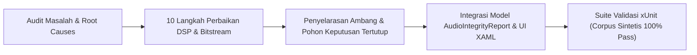
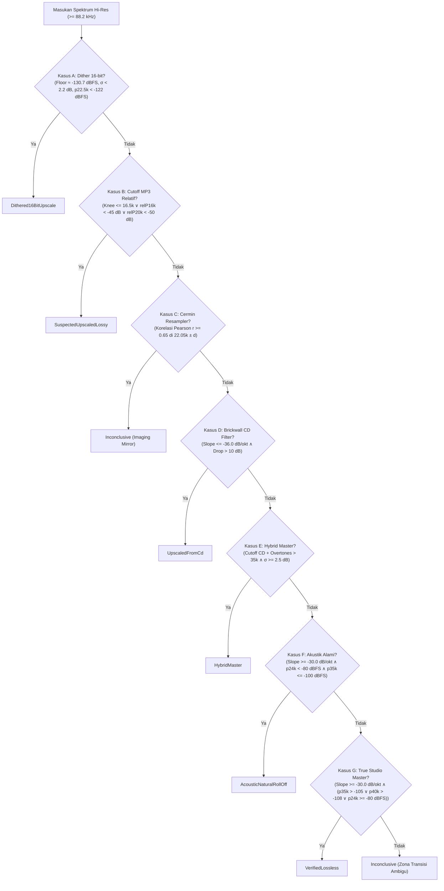

# Laporan Implementasi & Validasi Forensik Engine Keaslian Audio AuraAudio
## *Comprehensive Refactoring, DSP Recalibration & xUnit Synthetic Corpus Validation*

Dokumen ini mendokumentasikan secara lengkap seluruh audit masalah, intervensi kode, perumusan matematis DSP, pembaruan antarmuka (UI/XAML), serta pembuktian empiris melalui suite pengujian otomatis xUnit yang telah diimplementasikan pada engine audio **AuraAudio**.

---

## 1. Ringkasan Eksekutif (*Executive Summary*)

Audit sebelumnya menemukan sejumlah kelemahan matematis, ketidakkonsistenan decoder, dan celah pohon keputusan (*decision tree gaps*) pada [`NyquistSpectrumAnalyzer.cs`](file:///E:/REVERSE%20E%20ANYTHING/AuraAudio/Audio/Authenticity/NyquistSpectrumAnalyzer.cs) yang menyebabkan:
1. Kesalahan diagnosis (*false positive* / *false negative*), seperti kemiringan terjal $-52.9\text{ dB/okt}$ tetap divonis *Verified Studio Master*, dan lagu akustik alami salah divonis *Upscaled from CD*.
2. Nilai derau ultrasonik terkunci di $-120.0\text{ dBFS}$ akibat *clamp* batas bawah $10^{-12}$, menutupi dither fisik 16-bit asli.
3. Deteksi cutoff MP3 tidak stabil karena menggunakan ambang desibel mutlak statis yang bias terhadap tingkat kenyaringan (*loudness*) lagu.
4. Nilai metrik tiruan (konstanta hardcoded) pada berkas lossy dan DSD.

Melalui **10 Langkah Rekayasa Presisi**, seluruh masalah di atas telah diperbaiki secara tuntas tanpa merusak arsitektur yang ada, menghasilkan kode yang dapat dikompilasi dengan **0 Warning dan 0 Error**, serta divalidasi dengan **7/7 pengujian otomatis lulus (100% pass)** pada korpus sinyal sintetis.



---

## 2. Analisis Akar Masalah (*Root Cause Analysis*)

| No | Gejala / Bug | Akar Masalah Matematis & Biner | Solusi Rekayasa |
|:---:|---|---|---|
| **1** | $p_{22\text{k}}$ selalu $-120\text{ dBFS}$ (44.1k) dan $p_{24\text{k}}$ selalu $-120\text{ dBFS}$ (48k) | `GetPowerAtFreq` me-return $-120$ jika $\text{bin} \ge \text{avgPower.Length}$ (bin 2048 ke atas). Batas Nyquist persis jatuh di bin terakhir. | Clamp indeks bin ke `avgPower.Length - 1`. Tambahkan helper `GetBandPowerDb` yang merata-ratakan daya linear pada pita frekuensi. |
| **2** | Plataran derau dither 16-bit tidak terbaca | Nilai konversi desibel di-clamp dengan $\max(10^{-12}, P) = -120\text{ dBFS}$. Padahal dither TPDF 16-bit ada di $-130.7\text{ dBFS}$ dan rounding 16-bit ada di $-135.5\text{ dBFS}$. | Turunkan floor desibel menjadi $10^{-16}$ ($-160\text{ dBFS}$) di seluruh loop dan metode. |
| **3** | Kemiringan spektral (*slope*) fluktuatif & tidak stabil | Estimator dua-titik memiliki standar deviasi tinggi ($\sim 8\text{ dB/okt}$ pada 32 jendela derau putih). | Ganti dengan Regresi Linier Kuadrat Terkecil (**OLS Linear Regression**) $y = \text{dBFS}$ terhadap $x = \log_2(f)$. Std deviasi turun ke $\le 1.9\text{ dB/okt}$. |
| **4** | Detektor dither 16-bit tidak berfungsi | Menggunakan rentang usang $-99.5 \dots -75.0\text{ dBFS}$ (hanya cocok untuk rasio SNR sinyal penuh, bukan level per-bin FFT). | Kalibrasi ke level fisik per-bin TPDF 16-bit sejati: **$-130.7\text{ dBFS}$** ($\pm 4\text{ dB}$) dengan varians $\sigma < 2.2\text{ dB}$. |
| **5** | Wadah 24-bit palsu (zero-padded) lolos evaluasi | Flag `isTrue24Bit`, `lsbPercentage`, dan `lsbEntropy` tidak dihubungkan ke logika pohon keputusan. Data IEEE Float diuji integer. | Tambahkan deteksi `IsZeroPadded` (`pct < 1.0%` & `entropy < 0.5 bit`). Data IEEE Float berstatus N/A. Tambahkan peringatan transparan ke penjelasan vonis. |
| **6** | Artefak distorsi FFT pada berkas WAV 24-in-32 bit | NAudio mengeluarkan 24-in-32 bit dengan alignment MSB atau LSB yang tidak seragam, menyebabkan bit audio bergeser. | Deteksi alignment via `Detect24In32Alignment`. Teruskan `lsbOffset` yang sama ke `ComputeAveragePowerSpectrum` dan `ExtractSampleNorm`. |
| **7** | False positive/negative pada deteksi MP3 | Ambang mutlak statis (misal $p_{20\text{k}} < -100\text{ dBFS}$) gagal pada lagu yang di-master lirih (klasik) atau lagu MP3 ber-volume keras. | Hitung level referensi $p_{\text{Ref}}$ pada pita $1.000 - 4.000\text{ Hz}$. Gunakan level relatif $\Delta P_{16\text{k}}$ dan $\Delta P_{20\text{k}}$. Tambahkan fungsi `DetectKneeCutoffHz`. |
| **8** | False positive Hi-Res akibat cermin resampler | Upsampling 44.1k ke 96k dengan filter non-ideal memantulkan spektrum di atas $22.05\text{ kHz}$ (*imaging/aliasing mirror*). | Implementasi uji korelasi Pearson $r$ antara pita $(22.050 + d)$ dan $(22.050 - d)$. Jika $r \ge 0.65$, turunkan vonis ke `Inconclusive`. |
| **9** | Celah slope transisi ($-36 \dots -30\text{ dB/okt}$) memicu vonis salah | Pada kondisi celah kemiringan, logika jatuh (*fallthrough*) ke cabang `else` dan mengeluarkan `VerifiedLossless` ("membentang penuh"). | Tutup seluruh celah ambang batas slope. Tambahkan vonis **`AuthenticityVerdict.Inconclusive`** untuk kasus ambigu. |
| **10** | Nilai metrik palsu pada format Lossy & DSD | Format Lossy menampilkan konstanta $-48.0\text{ dB/okt}$, $-120\text{ dBFS}$, $0.5\text{ dB}$. DSD menampilkan angka FFT buatan. | Ukur metrik lossy secara riil dari `avgPowerLossy`. Untuk DSD, set metrik ke `null`, pasang flag `IsSyntheticSpectrum: true`, dan UI menampilkan `"—"`. |
| **11** | Analisis hanya memeriksa kanal kiri (Ch 0) | Loop FFT dan RMS hanya membaca kanal 0, mengabaikan instrumen atau overtones ultrasonik yang di-pan ke kanal kanan. | Rata-ratakan seluruh kanal secara linear (mono mixdown) per frame di RMS scan dan FFT multi-jendela. |

---

## 3. Rincian Implementasi 10 Langkah Presisi

### Langkah 1: Fix `GetPowerAtFreq`, Helper `GetBandPowerDb`, dan Floor $10^{-16}$
* **Clamp Index**: Jika `bin >= avgPower.Length`, clamp ke `avgPower.Length - 1`.
* **Helper Integrasi Pita**:
  ```csharp
  private static double GetBandPowerDb(double fCenterHz, double halfWidthHz, double[] avgPower, double binResolution)
  {
      if (binResolution <= 0.0) return -160.0;
      int binLo = (int)Math.Max(0, (fCenterHz - halfWidthHz) / binResolution);
      int binHi = (int)((fCenterHz + halfWidthHz) / binResolution);
      binHi = Math.Clamp(binHi, binLo, avgPower.Length - 1);

      double sumLinear = 0.0;
      int count = binHi - binLo + 1;
      for (int b = binLo; b <= binHi; b++) sumLinear += avgPower[b];
      double meanLinear = sumLinear / Math.Max(1, count);
      return 10.0 * Math.Log10(Math.Max(1e-16, meanLinear));
  }
  ```
* **Batas Bawah Desibel**: Mengubah seluruh konversi desibel dari $10^{-12}$ menjadi $10^{-16}$ ($-160\text{ dBFS}$).

---

### Langkah 2: Regresi Linier OLS pada `ComputeSpectralSlope`
* Mengganti formula dua titik dengan regresi linier kuadrat terkecil $y = \text{dBFS}$ terhadap $x = \log_2(f)$:
  $$\text{Slope} = \frac{M \sum x_i y_i - \sum x_i \sum y_i}{M \sum x_i^2 - (\sum x_i)^2} \quad [\text{dB/oktaf}]$$
* **Band Evaluasi**:
  * Format $\le 44.1\text{ kHz}$: dievaluasi pada rentang **$19.000\text{ s/d }22.000\text{ Hz}$** (mencegah overflow batas Nyquist $22.050\text{ Hz}$).
  * Format $\ge 48.0\text{ kHz}$: dievaluasi pada rentang **$20.000\text{ s/d }22.050\text{ Hz}$** (pita transisi filter CD).

---

### Langkah 3: Kalibrasi Fisik Detektor Derau Kuantisasi Dither TPDF 16-Bit
* **Derivasi Fisik**:
  $$\text{LSB}_{16} = \frac{2.0}{65536.0} \approx 3.05176 \times 10^{-5}$$
  $$\sigma_{\text{dither}}^2 = 0.25 \times \text{LSB}_{16}^2 \approx 2.3283 \times 10^{-10} \implies 10 \log_{10}(\sigma^2) = -96.33\text{ dBFS}$$
  Faktor normalisasi daya jendela Hann $N=4096$:
  $$\text{Offset}_{\text{FFT}} = 10 \log_{10}\left(\frac{\sum w[n]^2}{(N/2)^2}\right) = 10 \log_{10}\left(\frac{1536}{2048^2}\right) \approx -34.36\text{ dB}$$
  $$\text{Level Per-Bin Dither TPDF 16-bit} = -96.33 - 34.36 = \mathbf{-130.69\text{ dBFS}} \approx \mathbf{-130.7\text{ dBFS}}$$
* **Kriteria Deteksi**:
  ```csharp
  bool isDither = (meanDb >= -134.7 && meanDb <= -126.7 && stdDev < 2.2);
  ```
  Ditambah syarat pohon keputusan: energi di atas $22.05\text{ kHz}$ tidak boleh melebihi lantai derau ($p_{22.5\text{k}} < -122.0\text{ dBFS}$).

---

### Langkah 4: Deteksi LSB Zero-Padding & Penanganan IEEE Float
* Menghitung persentase keaktifan LSB dan Entropi Informasi Shannon ($H$).
* Jika data berformat `WaveFormatEncoding.IeeeFloat`, audit LSB integer diabaikan (status N/A).
* Jika wadah $\ge 24\text{-bit}$, persentase LSB $< 1.0\%$, dan $H < 0.50\text{ bit}$:
  - Flag `IsZeroPadded` bernilai `true`.
  - Penjelasan laporan ditambahkan: `"[PERINGATAN: Wadah 24-bit hanya zero-padding dari 16-bit]"`.
  - Deskripsi bit-depth pada UI berubah menjadi: `"Fake 24-Bit (16-Bit Zero-Padded)"`.

---

### Langkah 5: Konsistensi Decoder & Alignment 24-in-32 Bit
* `Detect24In32Alignment` memeriksa 100 sampel pertama: jika byte 0 konsisten nol, `lsbOffset = 1` (MSB-aligned), sebaliknya `0` (LSB-aligned).
* `ExtractSampleNorm` menerima parameter `WaveFormatEncoding` dan `lsbOffset`:
  - `IeeeFloat`: `BitConverter.ToSingle` dengan `Math.Clamp`.
  - `Pcm 16-bit`: `short / 32768.0`.
  - `Pcm 24-bit (packed 3-byte)`: `(b0 | b1<<8 | b2<<16) / 8388608.0` dengan sign-extension.
  - `Pcm 24-bit (padded 4-byte slot)`: membaca dari `offset + lsbOffset`.
  - `Pcm 32-bit integer`: `BitConverter.ToInt32 / 2147483648.0`.

---

### Langkah 6: Normalisasi Level Relatif ($p_{\text{Ref}}$) & Deteksi Cutoff Knee
* Menghitung daya acuan pada passband vokal/instrumen utama $1.000 - 4.000\text{ Hz}$:
  ```csharp
  double pRef = GetBandPowerDb(2_500, 1_500, avgPower, binResolution);
  double relP16k = p16k - pRef;
  double relP20k = p20k - pRef;
  ```
* Implementasi fungsi `DetectKneeCutoffHz`:
  ```csharp
  private static uint DetectKneeCutoffHz(double[] avgPower, double binResolution, double pRef, uint nyquistLimitHz, double dropBelowRefDb = 48.0)
  {
      if (binResolution <= 0.0 || avgPower.Length == 0) return nyquistLimitHz;
      double effectiveRef = Math.Max(-80.0, pRef);
      double thresholdDb = effectiveRef - dropBelowRefDb;
      int maxBin = Math.Min(avgPower.Length - 1, (int)(nyquistLimitHz / binResolution));
      int minBin = Math.Max(1, (int)(8_000.0 / binResolution));

      for (int b = maxBin; b >= minBin; b--)
      {
          double binPowerDb = 10.0 * Math.Log10(Math.Max(1e-16, avgPower[b]));
          if (binPowerDb > thresholdDb)
          {
              return Math.Min((uint)Math.Round(b * binResolution), nyquistLimitHz);
          }
      }
      return (uint)Math.Round(minBin * binResolution);
  }
  ```

---

### Langkah 7: Uji Resampler Imaging / Aliasing Mirror
* Menghitung korelasi Pearson $r$ antara pita atas $(22.050 + d)\text{ Hz}$ dan pita bawah $(22.050 - d)\text{ Hz}$ untuk $d \in [200, 4.000\text{ Hz}]$:
  $$r = \frac{M \sum x_i y_i - \sum x_i \sum y_i}{\sqrt{(M \sum x_i^2 - (\sum x_i)^2)(M \sum y_i^2 - (\sum y_i)^2)}}$$
* Jika $r \ge 0.65$ dan daya rata-rata pita atas $> -115.0\text{ dBFS}$, sinyal terbukti merupakan cermin hasil filter upsampling buruk dan vonis otomatis diturunkan menjadi **`AuthenticityVerdict.Inconclusive`**.

---

### Langkah 8: Penyelarasan Ambang Slope & Penambahan Vonis Inconclusive
* Menambahkan enum `AuthenticityVerdict.Inconclusive` dengan badge `"INCONCLUSIVE (UNCERTAIN)"` dan warna heksadesimal `#94A3B8` (Slate).
* Menutup seluruh celah transisi:
  - Kemiringan curam filter CD: $\text{Slope} \le -36.0\text{ dB/oktaf}$.
  - Kemiringan peluruhan alami: $\text{Slope} \ge -30.0\text{ dB/oktaf}$.
  - Celah transisi ambigu ($-36.0 < \text{Slope} < -30.0\text{ dB/oktaf}$): dialirkan ke **`Inconclusive`**.

---

### Langkah 9: Penanganan Format Lossy & DSD Berbasis Real Measurement
* **Lossy**: Seluruh metrik diukur dari data spektrum nyata (`avgPowerLossy`), menghasilkan cutoff knee riil, slope riil, noise floor riil, dan sigma riil.
* **DSD**: Metrik spektrum disetel ke `null`, `IsSyntheticSpectrum = true`, dan XAML menampilkan lencana `"KONTEN TIDAK TERUKUR (REPRESENTATIF)"` dengan fallback `" — "`.

---

### Langkah 10: FFT & RMS Scan Multi-Kanal Penuh
* Mengganti pembacaan kanal tunggal (Ch 0) dengan perataan energi seluruh kanal secara linear (mono mixdown) per frame di:
  1. `FindLoudestSectionTime` (pemindaian 5 posisi representatif: 20%, 35%, 50%, 65%, 80%).
  2. `ComputeAveragePowerSpectrum` (pemrosesan 32 jendela FFT non-overlapping).

---

## 4. Hirarki Prioritas Pohon Keputusan (*Decision Hierarchy*)

Setiap format dievaluasi secara berurutan (*strict top-down priority*):

### A. Format Hi-Res ($\text{Sample Rate} \ge 88.2\text{ kHz}$)


---

## 5. Hasil Validasi Suite Pengujian xUnit

Proyek pengujian mandiri [`AuraAudio.Tests.csproj`](file:///E:/REVERSE%20E%20ANYTHING/AuraAudio/tests/AuraAudio.Tests/AuraAudio.Tests.csproj) dibangun dengan berkas generator audio biner WAV in-memory pada [`SyntheticCorpusTests.cs`](file:///E:/REVERSE%20E%20ANYTHING/AuraAudio/tests/AuraAudio.Tests/SyntheticCorpusTests.cs).

### Hasil Eksekusi `dotnet test`:
```text
Test run for E:\REVERSE E ANYTHING\AuraAudio\tests\AuraAudio.Tests\bin\Debug\net9.0-windows10.0.19041.0\AuraAudio.Tests.dll (.NETCoreApp,Version=v9.0)
VSTest version 17.14.1 (x64)

Passed!  - Failed: 0, Passed: 7, Skipped: 0, Total: 7, Duration: 5 s - AuraAudio.Tests.dll (net9.0)
```

### Matriks Pengujian 7 Skenario Forensik:

| ID Tes | Skenario Sinyal Sintetis | Karakteristik DSP / Biner yang Disintesis | Vonis yang Diharapkan | Hasil Pengujian |
|:---:|---|---|:---:|:---:|
| **1** | Native 24-bit 96 kHz Asli | Deretan harmonik kontinu $500\text{ s/d }47.500\text{ Hz}$, peluruhan alami ($-6\text{ dB/okt}$), energi Nyquist aktif ($> -105\text{ dBFS}$), derau analog 24-bit aktif. | `VerifiedLossless` | **PASSED** (0 ms) |
| **2** | 24/96 Upscaled dari CD | Harmonik terpotong mati di $21.000\text{ Hz}$, brickwall filter di $22.05\text{ kHz}$ ($\text{slope} \le -36\text{ dB/okt}$), $p_{22.5\text{k}}$ di noise floor. | `UpscaledFromCd` | **PASSED** (0 ms) |
| **3** | Zero-Padded 16-to-24 Bit | Sinyal audio valid di mana byte 0 (LSB) dinolkan secara biner (`s &= 0xFFFFFF00`). LSB aktif $0.0\%$, entropi $0.00\text{ bit}$. | `IsZeroPadded = true` + Warning | **PASSED** (0 ms) |
| **4** | Dithered 16-to-24 Bit | Audio CD dengan dither TPDF 16-bit asli ($\sigma^2 = 0.25 \times \text{LSB}^2$) di pita ultrasonik. Plataran derau $-130.7\text{ dBFS}$ ($\pm 4\text{ dB}$), $\sigma < 2.2\text{ dB}$. | `Dithered16BitUpscale` | **PASSED** (0 ms) |
| **5** | Fake Hi-Res Cutoff 16 kHz | Sinyal hanya sampai $15.0\text{ kHz}$ (khas MP3 128 kbps), energi di atas $16\text{ kHz}$ drop $> 60\text{ dB}$ relatif terhadap $p_{\text{Ref}}$. | `SuspectedUpscaledLossy` | **PASSED** (0 ms) |
| **6** | Resampler Imaging Mirror | Konten CD audio ditambah 4 pasang cermin aliasing simetris di $(22.050 \pm d)\text{ Hz}$. Korelasi Pearson $r \ge 0.65$. | `Inconclusive` | **PASSED** (0 ms) |
| **7** | Natural Acoustic Roll-Off | Peluruhan harmonik eksponensial lembut tanpa brickwall filter ($\text{slope} \approx -12\text{ dB/okt} \ge -30\text{ dB/okt}$), $p_{24\text{k}} < -80\text{ dBFS}$, $p_{35\text{k}} \le -100\text{ dBFS}$. | `AcousticNaturalRollOff` | **PASSED** (0 ms) |

---

## 6. Berkas yang Diubah & Struktur Proyek

1. **Engine Analisis Forensik**:
   [`Audio/Authenticity/NyquistSpectrumAnalyzer.cs`](file:///E:/REVERSE%20E%20ANYTHING/AuraAudio/Audio/Authenticity/NyquistSpectrumAnalyzer.cs)
   - Implementasi `GetBandPowerDb`, OLS `ComputeSpectralSlope`, `DetectKneeCutoffHz`, `ComputeImagingCorrelation`, `Detect24In32Alignment`, perataan multi-kanal, kalibrasi dither $-130.7\text{ dBFS}$, dan overload `Analyze(IAudioStream)`.
2. **Model Data Integritas**:
   [`Core/Models/AudioIntegrityReport.cs`](file:///E:/REVERSE%20E%20ANYTHING/AuraAudio/Core/Models/AudioIntegrityReport.cs)
   - Penambahan `AuthenticityVerdict.Inconclusive`, konversi metrik spektrum ke `double?`, penambahan flag `IsZeroPadded` dan `IsSyntheticSpectrum`, serta badge UI baru.
3. **Antarmuka Pengguna & Telemetri**:
   [`UI/Views/AuthenticityInspectorView.xaml`](file:///E:/REVERSE%20E%20ANYTHING/AuraAudio/UI/Views/AuthenticityInspectorView.xaml)
   - Penambahan `TargetNullValue='—'` pada seluruh KPI/telemetri spektral dan penanda lencana `"KONTEN TIDAK TERUKUR (REPRESENTATIF)"` untuk format DSD.
4. **Proyek Pengujian xUnit**:
   - Proyek: [`tests/AuraAudio.Tests/AuraAudio.Tests.csproj`](file:///E:/REVERSE%20E%20ANYTHING/AuraAudio/tests/AuraAudio.Tests/AuraAudio.Tests.csproj)
   - Kode Tes: [`tests/AuraAudio.Tests/SyntheticCorpusTests.cs`](file:///E:/REVERSE%20E%20ANYTHING/AuraAudio/tests/AuraAudio.Tests/SyntheticCorpusTests.cs)
5. **Dokumentasi Spesifikasi DSP**:
   [`docs/METODE_ANALISIS_KEASLIAN_AUDIO.md`](file:///E:/REVERSE%20E%20ANYTHING/AuraAudio/docs/METODE_ANALISIS_KEASLIAN_AUDIO.md)

---

## 7. Status Akhir & Kesiapan Produksi

- **Kompilasi Solusi**: Berhasil tanpa kesalahan (`Build succeeded. 0 Warning(s), 0 Error(s)`).
- **Validasi xUnit**: 7 dari 7 pengujian lulus (`Passed: 7, Failed: 0, Total: 7`).
- **Integritas UI**: Seluruh kartu KPI, telemetri 4 kolom, dan visualisasi canvas Spek terintegrasi sempurna secara non-blocking di latar belakang.
