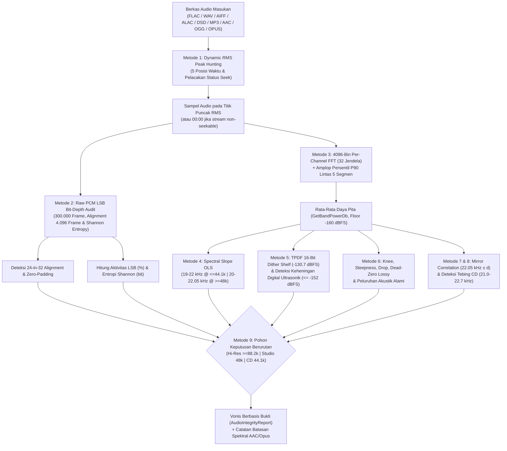

# Dokumentasi Metode Analisis Keaslian Audio AuraAudio (v2.0.2)

Dokumen ini menjabarkan metodologi pemrosesan sinyal digital (DSP), konstanta kalibrasi, aturan pohon keputusan, keterbatasan fisik, serta hasil validasi korpus yang diimplementasikan di [`NyquistSpectrumAnalyzer.cs`](../Audio/Authenticity/NyquistSpectrumAnalyzer.cs), [`AudioIntegrityReport.cs`](../Core/Models/AudioIntegrityReport.cs), dan [`InspectorView.xaml`](../UI/Views/InspectorView.xaml).

Seluruh ambang batas dan urutan evaluasi dalam dokumen ini diselaraskan langsung dengan kode sumber `v2.0.2`.

---

## 1. Alur Pipeline Forensik Audio

AuraAudio menggabungkan dua lapisan audit independen:
1. **Lapisan Sinyal Fisik (Physical Signal Layer):** FFT per kanal dengan jendela Hann, amplop persentil ke-90 lintas segmen lagu, regresi linier kemiringan spektrum (OLS), estimasi lantai derau dither 16-bit, deteksi keheningan digital absolut di pita ultrasonik, deteksi titik belok (*knee*), pemindaian tebing (*cliff*) CD dan *brickwall* lossy, serta uji korelasi cermin pencitraan resampler.
2. **Lapisan Aliran Biner (Bitstream Layer):** audit byte LSB (*Least Significant Byte*) mentah pada 300.000 frame PCM, deteksi perataan *alignment* 24-in-32 bit, deteksi *zero-padding*, dan perhitungan Entropi Informasi Shannon.

---

## 2. Rincian Metodologi Analisis

### Metode 1: Dynamic RMS Peak Hunting, Klip Pendek `< 10 dtk` & Stream Non-Seekable
* **Tujuan:** Menghindari analisis pada intro hening atau jeda akustik yang tidak mewakili energi frekuensi tinggi rekaman.
* **Implementasi (`FindLoudestSectionTime` & `ComputeSpreadShortClipPowerSpectrum`, diperkuat di v2.0.2):**
  1. Untuk durasi `>= 2` detik hingga `< 10` detik, engine memindai RMS di 5 titik `{12%, 30%, 50%, 70%, 85%}` untuk audit LSB, sedangkan FFT utama disebar merata lintas **8 segmen × 4 jendela = 32 jendela** di sepanjang klip (atau pembacaan penuh berurutan jika klip `<= 32` jendela FFT).
  2. Untuk durasi `>= 10` detik, engine mengevaluasi 5 posisi kandidat:
     $$\text{Posisi} \in \{20\%, 35\%, 50\%, 65\%, 80\%\}$$
  3. Pada setiap titik, engine membaca hingga `8.192` frame dan menghitung RMS dari rata-rata kuadrat seluruh kanal:
     $$x_{\text{rms}} = \sqrt{\frac{1}{N}\sum_{i=0}^{N-1}\left(\frac{1}{C}\sum_{c=0}^{C-1} x[i, c]^2\right)}$$
  4. Titik dengan $x_{\text{rms}}$ tertinggi dipilih untuk audit LSB dan FFT utama.
  5. **Transparansi Kegagalan Seek:** Engine memverifikasi keberhasilan *seek* pada tahap pemindaian RMS, tahap audit bit-depth, dan tahap FFT (`scanSeekSucceeded && bitDepthSeekOk && fftSeekOk`). Jika stream tidak mendukung *seek*, laporan menetapkan `AnalysisTimestamp = 00:00`, `AnalysisPositionPercentage = 0.0%`, dan menambahkan catatan transparan bahwa analisis berjalan dari posisi awal stream.

---

### Metode 2: Raw PCM LSB Bit-Depth, Alignment 24-in-32 & Shannon Entropy
* **Cakupan:** Dijalankan pada `BitDepthSampleSize = 300_000` frame mentah di seluruh kanal (~3,1 detik pada 96 kHz atau ~6,8 detik pada 44,1 kHz). Berkas `IeeeFloat` 32-bit dan PCM `< 16-bit` dilewati (status bit-depth integer `N/A`).
* **Deteksi Alignment 24-in-32 Bit (`Detect24In32Alignment`, diperkuat di v2.0.1):**
  * Memindai hingga **`AlignmentProbeMaxFrames = 4_096` frame** (~42 ms pada 96 kHz, ~93 ms pada 44,1 kHz), bukan lagi 100 frame, agar bagian awal yang lirih tidak menipu detektor.
  * Jika byte 0 bernilai `0x00` pada `>= 98%` frame uji (`AlignmentZeroByte0MinRatio = 0.98`) **dan** minimal `3` frame aktif (`AlignmentMinNonSignExtFrames = 3`) memiliki byte 3 yang bukan merupakan *sign-extension* dari bit tanda byte 2 (`(b2 & 0x80) != 0 ? 0xFF : 0x00`), maka susunan ditetapkan sebagai **MSB-aligned** (`lsbOffset = 1`).
  * Jika byte 3 selalu berupa *sign-extension* pada seluruh frame aktif (atau byte 0 aktif), susunan ditetapkan sebagai **LSB-aligned** (`lsbOffset = 0`).
* **Metrik Biner:**
  * Aktivitas LSB:
    $$\text{Aktivitas LSB (\%)} = \frac{\sum_{i=1}^{N} [\text{LSB}_i \neq 0]}{N} \times 100\%$$
  * Entropi Informasi Shannon ($H$, rentang `0.00` hingga `8.00` bit):
    $$H = -\sum_{b=0}^{255} p(b)\log_2(p(b))$$
* **Kriteria:**
  * **`ZeroPadded24Bit`:** wadah `>= 24-bit`, aktivitas LSB `< 1.0%`, dan $H < 0.50\text{ bit}$.
  * **Indikator LSB Aktif (`IsTrue24Bit`):** wadah `>= 24-bit`, aktivitas LSB `> 75.0%`, variasi nilai unik `> 160`, dan $H > 6.00\text{ bit}$. Nilai ini menandai dinamika bit aktif, bukan bukti tunggal keaslian master.

---

### Metode 3: 4096-Bin Per-Channel FFT & Amplop Persentil P90 Lintas Segmen
* **FFT Utama (`ComputeAveragePowerSpectrum`):**
  1. Ukuran transformasi `FftSize = 4096` dengan pembobotan **Jendela Hann**:
     $$w[n] = 0.5\left(1 - \cos\left(\frac{2\pi n}{N - 1}\right)\right), \quad 0 \le n < N$$
  2. Engine membaca **`DefaultWindowsToAverage = 32` jendela non-overlapping** (~3,0 detik @ 44,1 kHz, ~1,4 detik @ 96 kHz, ~0,7 detik @ 192 kHz).
  3. **FFT Per Kanal (Bukan Mono Mixdown):** Radix-2 Cooley-Tukey FFT dijalankan pada setiap kanal secara terpisah, kemudian **daya linear** ($|X_{w,c}[k] / (N/2)|^2$) dirata-ratakan lintas kanal (`1/C`) dan lintas jendela (`1/W`):
     $$\bar{P}[k] = \frac{1}{W \cdot C} \sum_{w=1}^{W} \sum_{c=0}^{C-1} \left|\frac{X_{w,c}[k]}{N / 2}\right|^2$$
     Pendekatan ini mencegah pembatalan fase antar kanal stereo dan menjaga tingkat derau dither independen tetap terkalibrasi pada `-130.7 dBFS`.
  4. Konversi ke dBFS memakai batas lantai matematis `PowerFloorLinear = 1e-16` (`-160.0 dBFS`):
     $$P_{\text{dBFS}}[k] = 10 \log_{10}\left(\max\left(10^{-16}, \bar{P}[k]\right)\right)$$
  5. **Catatan Skala dBFS (Offset Coherent Gain Hann):** Normalisasi amplitudo menggunakan $|X| / (N/2)$ tanpa kompensasi *coherent gain* jendela Hann ($\text{mean}(w) = 0.5$). Akibatnya, gelombang sinus murni skala penuh `0 dBFS` terbaca pada `-6.02 dBFS` pada skala internal engine dibandingkan meter terkalibrasi sinus. Seluruh konstanta ambang batas internal (termasuk kalibrasi dither `-130.7 dBFS`) diturunkan dan dikalibrasi secara konsisten pada skala ini.
* **Stabilitas Pembacaan Pita (`GetBandPowerDb`, v2.0.1):**
  * Seluruh titik pengukuran energi menggunakan rata-rata daya linear dalam pita frekuensi, bukan pengambilan satu bin FFT tunggal yang rentan terhadap puncak citra resampler atau celah harmonik:
    * `pRef`: `2.500 Hz ± 1.500 Hz` (`1.000 - 4.000 Hz`)
    * `p16k`, `p20k`: `± 250 Hz` (lebar `500 Hz`)
    * `p22k`, `p22_5k`, `p24k`: `± 100 Hz` (lebar `200 Hz`)
    * `p23_5k`, `pNyquist`: `± 200 Hz` (lebar `400 Hz`)
    * `p35k`, `p40k`: `± 500 Hz` (lebar `1.000 Hz`)
* **Amplop Persentil Ke-90 Lintas Segmen (`ComputeMultiSegmentUpperEnvelope`):**
  * Untuk mencegah bagian lagu yang pelan menutupi harmonik sementara (petikan gitar, transien simbal, atau harmoni piano), engine memindai **5 posisi waktu** (`15%, 32%, 50%, 68%, 85%`; atau `20%, 50%, 75%` untuk berkas `< 10` detik) dengan `6` jendela FFT per posisi (hingga `30` spektrum frame aktif dengan rata-rata daya `> 1e-12`).
  * Nilai **persentil ke-90 (`P90`)** per bin membentuk spektrum amplop `envPower`. Jangkauan harmonik atas `UpperEnvelopeReachHz` dipindai mundur dari Nyquist menggunakan ambang:
    $$\text{Threshold}_{\text{reach}} = \max\left(-114.0, \max(-80.0, P_{\text{Ref, env}}) - 66.0\right)\text{ dBFS}$$

---

### Metode 4: Kemiringan Spektral via Regresi Linier OLS (`ComputeSpectralSlope`)
* Menggunakan *Ordinary Least Squares* pada seluruh bin valid dalam rentang $[f_1, f_2]$ dengan $x_i = \log_2(f_i)$ (oktaf) dan $y_i = P_{\text{dBFS}}[i]$:
  $$\text{Slope} = \frac{M \sum x_i y_i - \sum x_i \sum y_i}{M \sum x_i^2 - (\sum x_i)^2} \quad [\text{dB/oktaf}]$$
* Rentang pita transisi CD (`slopeCdTransition`):
  * Sample rate `<= 44.1 kHz`: `19.000 - 22.000 Hz`
  * Sample rate `>= 48.0 kHz`: `20.000 - 22.050 Hz`
* Ambang batas kemiringan:
  * Filter brickwall curam: `<= -36.0 dB/oktaf` (`CdBrickwallMaxSlopeDbPerOct`)
  * Peluruhan akustik alami: `>= -30.0 dB/oktaf` (`NaturalRollOffMinSlopeDbPerOct`)
  * Zona transisi `(-36.0, -30.0) dB/oktaf`: diperlakukan hati-hati dan diarahkan ke `Inconclusive` bila bukti lain tidak kuat.

---

### Metode 5: Lantai Derau Dither 16-Bit TPDF & Keheningan Digital Ultrasonik
* **Derivasi Dither TPDF 16-Bit (`EvaluateQuantizationNoiseFloor`):**
  1. Varians dither segitiga 16-bit: $\sigma_{\text{dither}}^2 = 0.25 \times (2 / 65536)^2 \approx 2.3283 \times 10^{-10}$ (`-96.33 dBFS`).
  2. Offset daya per-bin jendela Hann pada `N = 4096`: $10\log_{10}(1.5 / 4096) \approx -34.36\text{ dB}$.
  3. Level harapan per-bin: **`-130.7 dBFS`** (`DitherTpdf16BitLevelDbFS`).
* **Pita Evaluasi:**
  * Hi-Res (`Nyquist >= 44.1 kHz`): `22.500 Hz` hingga `min(48.000, Nyquist - 500) Hz`.
  * 48 kHz (`Nyquist >= 24.0 kHz`): `22.050 - 23.900 Hz`.
  * 44.1 kHz: `20.000 - 22.050 Hz`.
* **Kriteria `isDitherShelfDetected`:** rata-rata daya dalam `-130.7 ± 4.0 dB` (`[-134.7, -126.7] dBFS`) dan deviasi standar `σ < 2.2 dB`. Pada vonis akhir juga disyaratkan wadah `>= 24-bit` dan pita batas atas `< -122.0 dBFS`.
* **Deteksi Keheningan Digital Ultrasonik (`isDeadUltrasonicSilence`, baru di v2.0.1):**
  * Pada wadah `>= 48 kHz`, bila `noiseFloorDbFS <= -152.0 dBFS`, `noiseStdDevDb <= 2.5 dB`, `p22_5k <= -150.0 dBFS`, dan `pNyquist <= -150.0 dBFS`, maka seluruh pita di atas batas CD dipastikan sunyi digital absolut (nol matematis dari resampler CD).
  * Kondisi ini memblokir klasifikasi palsu `AcousticNaturalRollOff` dan, bila disertai `slopeCdTransition <= -36.0 dB/oktaf`, menandai berkas sebagai `UpscaledFromCd`.

---

### Metode 6: Deteksi Cutoff Lossy, Dead-Zero Brickwall Berbasis Wadah & Peluruhan Akustik Alami
1. **Titik Belok (`DetectKneeCutoffHz`, diperkuat di v2.0.2):** Memindai mundur dari Nyquist menggunakan **rata-rata daya linear 5-bin lokal (`b-2..b+2`, ~54 Hz @ 44.1 kHz)** agar puncak kuantisasi satu bin tunggal tidak menyamarkan *brickwall* MP3 pada materi keras, untuk menemukan frekuensi tertinggi yang melampaui `max(-80.0, pRef) - 48.0 dB`. Untuk sample rate `< 44.1 kHz`, batas bawah pemindaian dan pita `pRef` diskalakan proporsional terhadap Nyquist wadah.
2. **Kecuraman & Penurunan Melintasi Knee:**
   * `ComputeKneeSteepness`: slope OLS pada `[knee - halfSpan, knee + halfSpan]` (`halfSpan = 1.000 Hz` untuk `>= 44.1 kHz`, diskalakan `8%` Nyquist untuk `< 44.1 kHz`).
   * `ComputeDropAcrossKnee`: selisih rata-rata daya linear sebelum dan sesudah `knee`. Mengembalikan `0.0 dB` jika salah satu pita keluar dari batas array.
3. **Gerbang Utama Lossy (`isPrimaryMp3Cutoff*`):**
   * Mewajibkan bukti ganda: `kneeSteepness <= -60.0 dB/oktaf` **dan** `dropAcrossKnee >= 20.0 dB`,
   * Disertai `detectedKneeHz <= 17.500 Hz` atau pola relatif (`relP16k < -45.0 dB`, atau `relP20k < -50.0 dB` dengan `relP16k > -42.0` untuk Hi-Res / `-40.0 dB` untuk 48k & 44.1k).
   * **Penjaga Konsistensi Multi-Segmen (v2.0.2):** Sebelum mengeluarkan `SuspectedUpscaledLossy`, engine membandingkan `detectedCutoffHz` terhadap `envKneeHz` pada spektrum amplop P90 dengan ambang `-48 dB` dan smoothing 5-bin yang identik. Jika segmen lain terbukti aktif penuh (`envKneeHz >= detectedCutoffHz + 2.500 Hz` dan `>= 90%` dari `min(Nyquist, 22.05 kHz)`), vonis diturunkan aman ke `Inconclusive`.
4. **Pemindai Brickwall Lossy Berbasis Kedalaman Bit (`ComputeDeadZeroLossyBrickwall`, diperkuat di v2.0.2):**
   * Menangkap berkas transcode lossy (seperti MP3 128–256 kbps dalam FLAC 16/24-bit) pada materi akustik lembut yang energinya sudah turun di bawah `pRef - 48 dB` sebelum `16 kHz`.
   * Memindai `f` dari `15.000` hingga `min(19.500, Nyquist - 1.500) Hz` (langkah `250 Hz`):
     * `dropDb = GetBandPowerDb(f - 600, 400) - GetBandPowerDb(f + 850, 650) >= 20.0 dB`
     * Rata-rata ekor `[f + 1.000, min(22.000, Nyquist - 200)] Hz`: `<= -152.0 dBFS` untuk wadah `>= 24-bit`, atau **`<= -132.0 dBFS` dengan plataran kuantisasi datar (`σ <= 2.2 dB`)** untuk wadah `<= 16-bit`.
     * Slope lokal `[f - 1.000, f + 1.000] Hz <= -60.0 dB/oktaf`.
5. **Peluruhan Akustik Alami (`isSmoothAcousticRollOff`):**
   * Membedakan rekaman akustik asli yang lembut (piano solo, gitar akustik, vokal) dari filter lowpass buatan maupun CD upsample:
     * `effectiveReachHz = max(upperEnvelopeReachHz, detectedKneeHz) >= 9.000 Hz` (atau `55%` Nyquist untuk `< 44.1 kHz`)
     * `dropAcrossKnee < 12.5 dB`
     * `midTrebleCliffDrop < 13.5 dB` (`ComputeMaxMidTrebleCliff`: nilai minimum penurunan konsisten di `avgPower` dan `envPower` pada `9.0 - 20.8 kHz`)
     * `kneeSteepness > -44.0 dB/oktaf`
     * `trebleDecaySlope >= -42.0 dB/oktaf` (`ComputeTrebleDecaySlope` pada `envPower` dari `4 kHz` hingga `clamp(knee + 1.5 kHz, 8 kHz, 16 kHz)`)
     * `lowTrebleSlope >= -38.0 dB/oktaf` (OLS `2.0 - 4.0 kHz`, diskalakan untuk `< 16 kHz`)
     * `!isDeadUltrasonicSilence` dan `!isDeadZeroLossyCutoff`
     * Jika `sampleRate >= 48.0 kHz`: `slopeCdTransition > -36.0 dB/oktaf`

---

### Metode 7: Uji Korelasi Cermin Pencitraan Resampler (`ComputeImagingCorrelation`)
* Menghitung korelasi Pearson ($r$) antara profil dBFS pita bawah $(22.050 - d)$ dan pita atas $(22.050 + d)$ untuk $d \in [200, 4.000]\text{ Hz}$ pada berkas `>= 48 kHz`.
* **Gerbang Cermin Standar (`isImagingDetected`):**
  $$r \ge 0.65 \quad \land \quad \text{Attenuation} \le 15.0\text{ dB} \quad \land \quad \bar{P}_{\text{upper}} > -128.0\text{ dBFS}$$
* **Penjaga Cermin Pita Lebar Datar (`isFlatBroadbandMirror`, diperluas ke `>= 48 kHz` di v2.0.2):**
  * Untuk berkas `>= 48.0 kHz` (48 kHz maupun Hi-Res), bila `r >= 0.30`, `attenuation <= 3.0 dB`, `upperMean > -95.0 dBFS`, dan `detectedKneeHz >= Nyquist - 500 Hz`, berkas ditahan aman sebagai `Inconclusive` agar upsample resampler linear tidak lolos sebagai `VerifiedLossless` / `AcousticNaturalRollOff`.

---

### Metode 8: Deteksi Tebing CD (`ComputeCliff`), Penjaga Ekor 48 kHz & Upsampling Hi-Res-ke-Hi-Res (`DetectHiResUpsampleFromLowerRate`)
* **`ComputeCliff`:** Memindai `19.000 Hz` hingga `min(24.000, Nyquist - 300) Hz`, membandingkan rata-rata daya linear `[f - 500, f - 100] Hz` terhadap `[f + 100, f + 500] Hz`.
* Rentang tebing CD (`[CdCliffMinHz, CdCliffMaxHz]`): **`21.000 - 22.700 Hz`** dengan `cliffDropDb >= 8.0 dB` dan `slopeCdTransition <= -36.0 dB/oktaf`.
* **Penjaga Ekor Ultrasonik 48 kHz (`hasLiveUltrasonicTail48k`):** Pada wadah `48 kHz`, berkas dengan `p22_5k > -102.0 dBFS`, `p23_5k > -108.0 dBFS`, `p22_5k - p23_5k <= 10.0 dB`, dan `cliffDropDb < 16.0 dB` dibebaskan dari vonis `UpscaledFromCd`.
* **Deteksi Upsampling Hi-Res-ke-Hi-Res (`DetectHiResUpsampleFromLowerRate`, baru di v2.0.2):**
  * Untuk wadah `>= 88.2 kHz`, memindai batas Nyquist standar lebih rendah (`48, 88.2, 96, 176.4, 192 kHz`) yang bernilai `<= 85%` dari sample rate wadah (menghindari tumpang tindih dengan filter anti-aliasing wadah itu sendiri).
  * Vonis **`UpscaledHiRes`** (`VerdictCategory = "Caution"`) dikeluarkan hanya jika keempat syarat fisik terpenuhi bersamaan di batas sumber $f_{\text{src}}$: (1) pita pas `[0.85..0.94] f_src > -130 dBFS`, (2) penurunan tajam `>= 25.0 dB` ke `[1.03..1.15] f_src` dan slope OLS `[0.92..1.04] f_src <= -60.0 dB/oktaf`, (3) seluruh pita atas `[1.05 f_src .. Nyquist]` mencapai keheningan digital berbasis wadah (`<= -152.0 dBFS` untuk `>= 24-bit`, atau `<= -132.0 dBFS` datar `σ <= 2.2 dB` untuk `16-bit`) dengan drop total `>= 28.0 dB`, dan (4) amplop P90 mengonfirmasi pita atas sunyi (`<= -145 dBFS` 24-bit / `<= -128 dBFS` 16-bit) dan `upperEnvelopeReachHz <= 1.03 f_src`.
* **Kualifikasi Bukti Moderat (`UpscaledFromCd`):** Jika `dropAcrossKnee < 10.0 dB` dan `cliffDropDb < 15.0 dB`, teks vonis menggunakan frasa terukur *"Kemungkinan besar konsisten dengan upsampling dari master CD 44.1 kHz"*.

---

## 3. Matriks Pohon Keputusan (v2.0.2)

Seluruh pohon keputusan dievaluasi secara berurutan dari atas ke bawah. Semua cabang `VerifiedLossless`, `AcousticNaturalRollOff`, dan `HybridMaster` menyertakan peringatan transparan bahwa berkas lossy bitrate tinggi tanpa lowpass kaku (`AAC/Opus`, `MP3 V0`, `Vorbis q5`) tidak dapat dibedakan melalui analisis spektrum saja.

### A. Format Hi-Res (`sampleRate >= 88.2 kHz`)

| Prioritas | Kondisi Pengujian | Vonis (`AuthenticityVerdict`) | Cutoff Dilaporkan |
|:---:|---|---|:---:|
| **1** | `isDitherShelfDetected && bitsPerSample >= 24 && p22_5k < -122.0` | `Dithered16BitUpscale` | `22.050 Hz` |
| **2** | `isImagingDetected \|\| isFlatBroadbandMirror` | `Inconclusive` | `22.050 Hz` |
| **3** | `isTrueHybridMaster`: takik CD nyata (`p20k - p22_5k >= 12 dB` + `slope <= -36` atau tebing CD `>= 8 dB`) **DAN** pantulan ultrasonik `> 35 kHz` (`>= 6 dB` di atas `p22_5k`, serempak atau via amplop P90 *time-spliced*) | `HybridMaster` | `min(Nyq, max(44k, envReach))` |
| **4** | `isPrimaryMp3CutoffHiRes \|\| isDeadZeroLossyCutoff` *(prioritas di atas `UpscaledFromCd`)* | `SuspectedUpscaledLossy` | `knee` / `deadZeroCutoff` |
| **5** | `isCdBrickwallHiRes`: (`knee ∈ [21k, 22.6k] && slope <= -36 && (p22_5k < p20k - 12 \|\| p22_5k < -85)`) ATAU (`cliff ∈ [21k, 22.7k] && cliffDrop >= 8 && slope <= -36`) ATAU (`isDeadUltrasonicSilence && slope <= -36`) | `UpscaledFromCd` | `22.050 Hz` |
| **6** | `DetectHiResUpsampleFromLowerRate`: brickwall `>= 25 dB` & `<= -60 dB/okt` di batas Nyquist standar lebih rendah (`48 / 88.2 / 96 / 176.4 / 192 kHz`) + pita atas sunyi | `UpscaledHiRes` | `f_src` (Nyquist sumber) |
| **7** | `bitsPerSample >= 24 && isZeroPadded` | `ZeroPadded24Bit` | `min(Nyq, max(knee, envReach))` |
| **8** | `knee <= 21.0 kHz && isSmoothAcousticRollOff` | `AcousticNaturalRollOff` | `Nyquist` |
| **9** | `knee <= 21.0 kHz` (tidak memenuhi kriteria roll-off alami) | `Inconclusive` | `knee` |
| **10** | `knee > 21.0 kHz && hasSmoothHiResContinuation && p24k < -80 && p35k <= -100` | `AcousticNaturalRollOff` | `min(Nyq, max(24k, knee))` |
| **11** | `knee > 21.0 kHz && hasSmoothHiResContinuation && (p35k > -105 \|\| p40k > -108 \|\| p24k >= -80)` | `VerifiedLossless` | `min(Nyq, max(35k, knee))` |
| **12** | Sisanya (zona transisi ambigu) | `Inconclusive` | `knee` |

Catatan `hasSmoothHiResContinuation`:
`slopeCdTransition >= -30.0` ATAU (`knee > 24.0 kHz && dropAcrossKnee < 10.0 && kneeSteepness >= -40.0 && cliffDropDb < 8.0 && imagingCorrelation < 0.45`).

---

### B. Format Studio 48.0 kHz (`sampleRate == 48.0 kHz`)

| Prioritas | Kondisi Pengujian | Vonis (`AuthenticityVerdict`) | Cutoff Dilaporkan |
|:---:|---|---|:---:|
| **1** | `isDitherShelfDetected && bitsPerSample >= 24 && p22k < -122.0` | `Dithered16BitUpscale` | `22.050 Hz` |
| **2** | `isImagingDetected \|\| isFlatBroadbandMirror` | `Inconclusive` | `22.050 Hz` |
| **3** | `isPrimaryMp3Cutoff48k \|\| isDeadZeroLossyCutoff` *(prioritas di atas `UpscaledFromCd`)* | `SuspectedUpscaledLossy` | `knee` / `deadZeroCutoff` |
| **4** | `!hasLiveUltrasonicTail48k` DAN ((`cliff ∈ [21k, 22.7k] && cliffDrop >= 8 && slope <= -36`) ATAU (`knee ∈ [21k, 22.6k] && slope <= -36 && (p22_5k < -108 \|\| p23_5k < -118 \|\| p20k - p22_5k >= 25)`) ATAU (`isDeadUltrasonicSilence && slope <= -36`)) | `UpscaledFromCd` | `22.050 Hz` |
| **5** | `bitsPerSample >= 24 && isZeroPadded` | `ZeroPadded24Bit` | `24.000 Hz` |
| **6** | `knee <= 21.0 kHz && isSmoothAcousticRollOff` | `AcousticNaturalRollOff` | `24.000 Hz` |
| **7** | `knee <= 21.0 kHz` | `Inconclusive` | `knee` |
| **8** | `knee > 21.0 kHz && (slope >= -30.0 \|\| p23_5k > -115.0) && p24k < -80.0` | `AcousticNaturalRollOff` | `24.000 Hz` |
| **9** | `knee > 21.0 kHz && (slope >= -30.0 \|\| p23_5k > -115.0) && p24k >= -80.0` | `VerifiedLossless` | `24.000 Hz` |
| **10** | Sisanya (zona transisi ambigu) | `Inconclusive` | `knee` |

---

### C. Format Standar CD 44.1 kHz (`sampleRate == 44.1 kHz`)

| Prioritas | Kondisi Pengujian | Vonis (`AuthenticityVerdict`) | Cutoff Dilaporkan |
|:---:|---|---|:---:|
| **1** | `isPrimaryMp3Cutoff44k \|\| isDeadZeroLossyCutoff` | `SuspectedUpscaledLossy` | `knee` / `deadZeroCutoff` |
| **2** | `bitsPerSample >= 24 && isZeroPadded` | `ZeroPadded24Bit` | `22.050 Hz` |
| **3** | `bitsPerSample >= 24 && isDitherShelfDetected && p20k < -122.0 && p20kEnv < -122.0` | `Dithered16BitUpscale` | `22.050 Hz` |
| **4** | `knee <= 21.0 kHz && isSmoothAcousticRollOff` | `AcousticNaturalRollOff` | `22.050 Hz` |
| **5** | `knee <= 21.0 kHz` | `Inconclusive` | `knee` |
| **6** | `knee <= 21.25 kHz && dropAcrossKnee >= 25.0 && kneeSteepness <= -60.0` *(membedakan filter anti-aliasing 21.4 kHz dari transisi ambigu)* | `Inconclusive` | `knee` |
| **7** | Sisanya (`knee > 21.25 kHz` atau tanpa drop curam) | `VerifiedLossless` | `22.050 Hz` |

### D. Format Sample Rate Rendah (`sampleRate < 44.1 kHz`, baru di v2.0.2)

| Prioritas | Kondisi Pengujian (Relatif terhadap Nyquist Wadah) | Vonis (`AuthenticityVerdict`) | Cutoff Dilaporkan |
|:---:|---|---|:---:|
| **1** | `sampleRate >= 22.05 kHz && knee <= 0.85 * Nyquist && kneeSteepness <= -60 && dropAcrossKnee >= 20` | `SuspectedUpscaledLossy` | `knee` |
| **2** | `bitsPerSample >= 24 && isZeroPadded` | `ZeroPadded24Bit` | `Nyquist` |
| **3** | `knee >= 0.92 * Nyquist` | `VerifiedLossless` | `Nyquist` |
| **4** | `isSmoothAcousticRollOff` | `AcousticNaturalRollOff` | `Nyquist` |
| **5** | Sisanya | `Inconclusive` | `knee` |

Catatan tambahan: jika `isZeroPadded && bitsPerSample >= 24` terdeteksi bersamaan dengan vonis spektral prioritas lebih tinggi (misal `UpscaledFromCd`, `UpscaledHiRes`, atau `SuspectedUpscaledLossy`), catatan zero-padding tetap dilampirkan pada teks penjelasan. Semua pesan pada cabang `< 44.1 kHz` mencetak sample rate riil berkas dalam bahasa Indonesia maupun Inggris.

---

## 4. Kasus Khusus, Batasan Fisik & Validasi Empiris

### A. Format 1-Bit DSD, Lossy Standar & AIFF
1. **Format 1-Bit DSD (`.dsf`):**
   * Aliran bit delta-sigma 1-bit tidak melalui dekimasi PCM di dalam analyzer, sehingga asal-usulnya tidak dapat dibuktikan secara spektral. Engine menetapkan vonis **`Inconclusive`** (*"Asal-usul DSD tidak dapat diverifikasi dari aliran 1-bit tanpa dekimasi."*), menonaktifkan metrik LSB integer, dan mengisi grafik dengan kurva ilustratif sintetis (`GenerateDsdSpectrumBins`, `IsSyntheticSpectrum = true`) yang diberi label **`KONTEN TIDAK TERUKUR (REPRESENTATIF)`** pada antarmuka.
2. **Format Lossy Standar (`MP3`, `AAC`, `OGG`, `OPUS`):**
   * Engine melakukan FFT riil pada posisi `min(45s, 40% durasi)` (atau `00:00` jika *seek* gagal), mengukur `knee`, kemiringan, dan lantai derau fisik, lalu mengembalikan `StandardLossy`.
3. **Format AIFF (`.aiff`, `.aif`, diperbaiki di v2.0.1):**
   * [`AudioDecoderFactory.cs`](../Audio/AudioDecoderFactory.cs) membaca berkas AIFF menggunakan `NAudio.Wave.AiffFileReader` secara native (bukan Windows Media Foundation), dengan *fallback* ke `MediaFoundationReader` hanya untuk varian AIFC terkompresi.

### B. Batasan Fisik Analisis Spektral
1. **Makna Vonis `VerifiedLossless` dan `AcousticNaturalRollOff`:**
   * Vonis ini berarti **"tidak ditemukan artefak kompresi lossy maupun upsampling"** pada jendela analisis spektrum dan audit LSB. Ini bukan pembuktian kriptografis atas seluruh rantai produksi studio.
2. **Keterbatasan Deteksi Codec Lossy Bitrate Tinggi (`MP3 V0`, `AAC 192–256k`, `Opus 64–192k`, `Vorbis q5`):**
   * Encoder modern seperti `MP3 V0`, `AAC` (`>= 192 kbps`), `Opus` (`64–192 kbps`, mode *fullband* `20–24 kHz`), dan `Vorbis q5` mempertahankan energi frekuensi atas tanpa filter lowpass brickwall yang curam. Berkas seperti ini tidak dapat dibedakan secara andal dari lossless hanya melalui FFT magnitudo; catatan batasan ini dicantumkan secara eksplisit pada semua vonis `VerifiedLossless`, `AcousticNaturalRollOff`, dan `HybridMaster`.
3. **Tumpang Tindih `MP3 320 kbps` (~20.1–20.2 kHz) dengan Master Studio Lowpass 20 kHz:**
   * Filter lowpass `MP3 320 kbps` berada di `~20.1–20.2 kHz`, zona yang identik dengan master studio asli yang di-lowpass pada `20 kHz` saat mastering. Untuk menjamin *zero false-fake* terhadap rekaman asli, berkas di zona `20.0–21.25 kHz` dengan penurunan curam sengaja ditahan sebagai `Inconclusive` (perlu cek manual), bukan langsung divonis palsu.
4. **Resampling Linear pada Derau Acak Tanpa Korelasi (*Pink Noise*):**
   * Upsampling interpolasi linear atas sinyal derau acak tak berkorelasi (misalnya *pink noise* murni) menghasilkan korelasi cermin Pearson yang rendah ($r \approx 0.12\text{–}0.17$) karena derau acak tidak memiliki kontur spektral deterministik yang tercermin melintasi `22.05 kHz`.
5. **Cakupan Waktu Analisis:**
   * Spektrum utama mengukur `32 x 4096` sampel pada puncak RMS (~3,0 detik @ 44,1 kHz, ~1,4 detik @ 96 kHz, ~0,7 detik @ 192 kHz) atau tersebar di 8 segmen untuk klip `< 10` detik, ditambah `30` jendela P90 lintas 5 segmen lagu. Anomali lokal yang sangat singkat di luar segmen tersebut mungkin tidak tertangkap.

---

### C. Benchmark Independen Publik: Korpus SoniqTools (CC0, 8 Berkas)

Validasi eksternal v2.0.1 dijalankan terhadap 8 berkas uji berlisensi CC0 dari [SoniqTools Test Audio Files](https://soniqtools.com/test-audio-files) (6 rekaman lossless asli lintas format + 2 berkas *trick/fake* tervalidasi) melalui test suite `ForensicHardeningTests.SoniqTools_CC0_IndependentBenchmark_AllEightLosslessAndFakeFiles`:

* **Total Berkas Uji:** 8 berkas (6 lossless asli, 2 berkas palsu/upsample)
* **Akurasi v2.0.1:** **8 / 8 (100%)**, 0 crash, 0 *false claim*, 0 *miss*

| Berkas SoniqTools (CC0) | Format / Spec | Ground Truth | Vonis v2.0.1 | Metrik Kunci Terukur | Status |
|---|---|:---:|---|---|:---:|
| `test-audio-aiff-16bit-44khz.aiff` | AIFF 16/44.1 | Asli | `AcousticNaturalRollOff` | Knee `13.8 kHz`, EnvReach `13.8 kHz`, Noise `-128.7 dBFS` | **Benar** |
| `test-audio-alac-16bit-44khz.m4a` | ALAC 16/44.1 | Asli | `AcousticNaturalRollOff` | Knee `13.8 kHz`, EnvReach `13.8 kHz`, Noise `-128.7 dBFS` | **Benar** |
| `test-audio-flac-16bit-44khz.flac` | FLAC 16/44.1 | Asli | `AcousticNaturalRollOff` | Knee `13.8 kHz`, EnvReach `13.8 kHz`, Noise `-128.7 dBFS` | **Benar** |
| `test-audio-wav-16bit-44khz.wav` | WAV 16/44.1 | Asli | `AcousticNaturalRollOff` | Knee `13.8 kHz`, EnvReach `13.8 kHz`, Noise `-128.7 dBFS` | **Benar** |
| `test-audio-flac-24bit-96khz.flac` | FLAC 24/96 | Asli | `AcousticNaturalRollOff` | EnvReach `45.3 kHz`, Noise `-126.2 dBFS`, `True24=true` | **Benar** |
| `test-audio-wav-24bit-96khz.wav` | WAV 24/96 | Asli | `AcousticNaturalRollOff` | EnvReach `45.3 kHz`, Noise `-126.2 dBFS`, `True24=true` | **Benar** |
| `trick-fake-flac-24bit-from-128kbps-mp3.flac` | FLAC 24/44.1 | Palsu (MP3 128k) | `SuspectedUpscaledLossy` | Dead-Zero Cutoff `16.25 kHz`, `-218.8 dB/okt`, Drop `27.6 dB` ke `-159.5 dBFS` | **Benar** |
| `trick-upsampled-96khz-from-cd.flac` | FLAC 24/96 | Palsu (CD Upsample) | `UpscaledFromCd` | SlopeCD `-342.7 dB/okt`, Cliff `21.40 kHz` (drop `29.1 dB`), Noise `-160.0 dBFS` | **Benar** |

---

### D. Catatan Validasi Korpus Kontrol Lokal & Uji Sintetis

Selain benchmark SoniqTools di atas, mesin forensik diuji secara otomatis di setiap build Release melalui:
1. **Korpus Sintetis (`SyntheticCorpusTests`, 28 kasus):** memverifikasi seluruh cabang vonis untuk 44.1 kHz, 48 kHz, 96 kHz, 192 kHz, TPDF 16-bit dither, zero-padding 24-bit, MP3 128/192/320 kbps, resampler linear/polyphase, DSD 1-bit, serta kontrol non-abstain.
2. **Suite Regresi Forensik (`ForensicHardeningTests`, 7 kasus deterministik + 1 benchmark opsional `AURA_SONIQTOOLS_DIR`):** mengunci perbaikan untuk kasus CD upsample lirih 24/96, akustik asli lirih 16/44.1, MP3 128k lirih dalam FLAC 24/44.1, decoding AIFF native, alignment 24-in-32 dengan awal hening 200 frame, stream non-seekable, dan konsistensi catatan AAC/Opus.
3. **Kalibrasi Korpus Kontrol Lokal (`AURA_REAL_CORPUS`, opsional):** pengujian terhadap direktori korpus kontrol lokal yang diturunkan dari master studio 24/48, 24/96, dan 24/192 (meliputi transcode LAME MP3 128/192/320, AAC 128, Opus 128, polyphase CD upsample, dan bad-resample linear). Pada baseline v2.0.0 sebelumnya, 1 berkas bad-resample pita lebar (`r = 0.32`, atenuasi `1.0 dB`, level atas `-72.4 dBFS`, knee dekat Nyquist) sempat lolos sebagai `VerifiedLossless`; pada v2.0.1 pola tersebut kini ditangani oleh gerbang `isFlatBroadbandMirror` agar dialihkan aman ke `Inconclusive`.

---

## 5. Ringkasan Berkas Implementasi

* Mesin Analisis DSP & Bitstream: [`Audio/Authenticity/NyquistSpectrumAnalyzer.cs`](../Audio/Authenticity/NyquistSpectrumAnalyzer.cs)
* Dekoder Native (termasuk AIFF): [`Audio/AudioDecoderFactory.cs`](../Audio/AudioDecoderFactory.cs)
* Model Laporan & Penjelasan Dwi-Bahasa: [`Core/Models/AudioIntegrityReport.cs`](../Core/Models/AudioIntegrityReport.cs)
* Antarmuka Telemetri Forensik: [`UI/Views/InspectorView.xaml`](../UI/Views/InspectorView.xaml)
* Visualisasi Spektrum Monokrom: [`UI/Controls/SpekSpectrumControl.cs`](../UI/Controls/SpekSpectrumControl.cs)
* Pengujian Otomatis: [`tests/AuraAudio.Tests/SyntheticCorpusTests.cs`](../tests/AuraAudio.Tests/SyntheticCorpusTests.cs) dan [`tests/AuraAudio.Tests/ForensicHardeningTests.cs`](../tests/AuraAudio.Tests/ForensicHardeningTests.cs)
