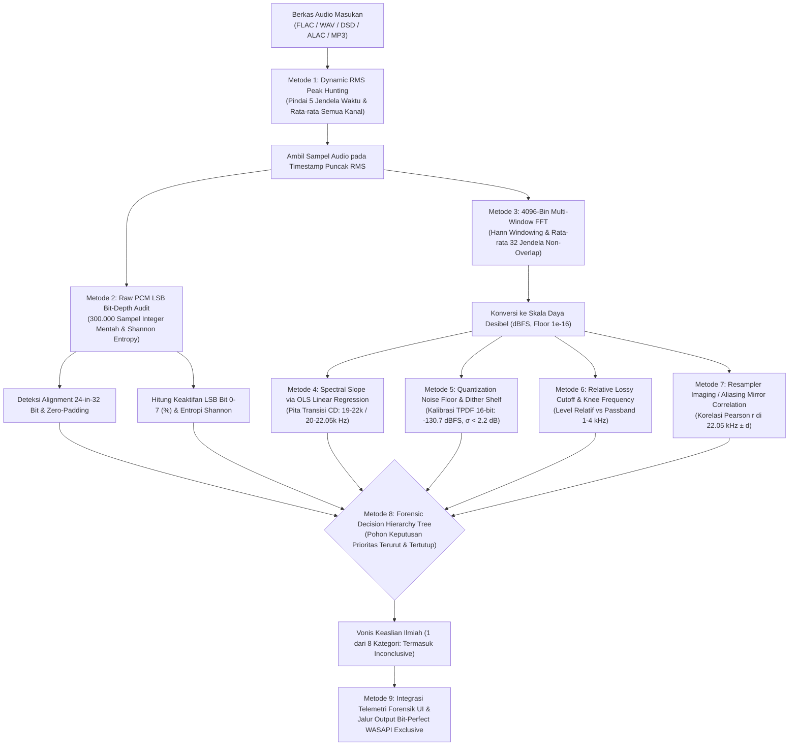

# Dokumentasi Lengkap Metode Analisis Keaslian Audio AuraAudio
## *Forensic Digital Signal Processing (DSP) & Raw Bitstream Audit Engine*

Dokumen ini menjabarkan seluruh metodologi ilmiah, rumus matematika, dan alur kerja komputasi yang diimplementasikan pada mesin pendeteksi keaslian audio **AuraAudio** ([`NyquistSpectrumAnalyzer.cs`](../Audio/Authenticity/NyquistSpectrumAnalyzer.cs)), arsitektur model ([`AudioIntegrityReport.cs`](../Core/Models/AudioIntegrityReport.cs)), serta visualisasi telemetri ([`InspectorView.xaml`](../UI/Views/InspectorView.xaml)).

---

## 1. Alur Pipeline Forensik Audio

AuraAudio menggunakan pendekatan hibrida **dua lapis (*dual-layer forensics*)**:
1. **Lapisan Fisik Sinyal (*Physical Signal Layer*)**: Transformasi Fourier (FFT), regresi linier kemiringan spektrum (*spectral slope*), estimasi derau kuantisasi dither shelf, deteksi frekuensi cutoff knee, dan uji korelasi pencitraan cermin resampler (*imaging/aliasing mirror*).
2. **Lapisan Biner Aliran Data (*Bitstream Layer*)**: Audit nilai byte LSB (*Least Significant Byte*) mentah, deteksi perataan *alignment* 24-in-32 bit, deteksi *zero-padding*, dan perhitungan Entropi Informasi Shannon.

---

## 2. Rincian Metodologi Analisis

### Metode 1: Dynamic RMS Peak Hunting (Deteksi Segmen Representatif)
* **Latar Belakang & Masalah**:
  Pengujian spektrum pada titik statis (misalnya hanya di detik ke-10 atau di tengah durasi) rentan menghasilkan diagnosis keliru (*false diagnosis*). Jika segmen tersebut bertepatan dengan *intro* hening, petikan akustik lembut, atau jeda vokal tanpa simbal/perkusi, audio beresolusi tinggi asli bisa salah didiagnosis kekurangan energi frekuensi tinggi.
* **Algoritma & Implementasi**:
  1. Engine mengevaluasi **5 posisi waktu representatif**:
     $$\text{Posisi} \in \{20\%, 35\%, 50\%, 65\%, 80\%\}$$
  2. Pada setiap titik, engine membaca 8192 frame sampel audio dan merata-ratakan energi seluruh kanal secara linear:
     $$x_{\text{frame}}[i] = \frac{1}{C}\sum_{c=0}^{C-1} x[i, c]$$
     $$x_{\text{rms}} = \sqrt{\frac{1}{N}\sum_{i=1}^N \left(\frac{1}{C}\sum_{c=0}^{C-1} x[i, c]^2\right)}$$
  3. Titik waktu dengan nilai $x_{\text{rms}}$ tertinggi ditetapkan sebagai **Puncak Klimaks Lagu (*Loudest Section*)**.
  4. Seluruh analisis lanjutan (FFT multi-jendela dan audit biner LSB) dieksekusi tepat pada posisi ini. Posisi dicatat secara transparan pada laporan telemetri (misal: `02:55 (65.0%)`).

---

### Metode 2: Raw PCM LSB Bit-Depth & Shannon Entropy Audit
* **Latar Belakang & Masalah**:
  Banyak berkas yang dipasarkan sebagai *24-bit Studio Master*, namun sebenarnya merupakan hasil konversi dari berkas 16-bit biasa yang bit bawahnya hanya diisi angka nol (*zero-padding*).
  Selain itu:
  - Berkas IEEE Float 32-bit (`WaveFormatEncoding.IeeeFloat`) tidak boleh diuji bit-depth integer karena representasi mantissa float akan mendistorsi nilai LSB byte integer (ditetapkan berstatus *N/A*).
  - Berkas WAV 24-in-32 bit memiliki dua format penyusunan (*alignment*): **MSB-aligned** (byte 0 padding kosong `0x00`, LSB di byte 1) dan **LSB-aligned** (LSB di byte 0). Ketidakkonsistenan decoder dapat menyebabkan bit audio salah terbaca sebagai nol.
* **Algoritma & Implementasi**:
  1. Membaca **300.000 sampel data PCM mentah** langsung dari stream audio.
  2. Menentukan *alignment* byte 24-in-32 bit secara otomatis via `Detect24In32Alignment`: jika byte 0 adalah nol pada seluruh sampel uji, pergeseran LSB `lsbOffset = 1` (MSB-aligned), sebaliknya `0` (LSB-aligned).
  3. **Aktivitas LSB**: Menghitung persentase sampel dengan byte LSB non-zero:
     $$\text{Aktivitas LSB (\%)} = \frac{\sum_{i=1}^{N} [LSB_i \neq 0]}{N} \times 100\%$$
  4. **Entropi Informasi Shannon ($H$)**:
     $$H = -\sum_{b=0}^{255} p(b) \log_2\left(p(b)\right)$$
     *Di mana $p(b)$ adalah probabilitas kemunculan nilai byte $b$.*
* **Kriteria Deteksi**:
  * **Fake 24-Bit (Zero-Padded 16-Bit)**: Wadah $\ge 24\text{-bit}$, $\text{Aktivitas LSB} < 1.0\%$, dan $H < 0.50\text{ bit}$. Flag `IsZeroPadded` diaktifkan dan peringatan transparan ditambahkan ke penjelasan vonis.
  * **LSB Aktif**: $\text{Aktivitas LSB} > 75.0\%$, variasi nilai unik $> 160$, dan $H > 6.00\text{ bit}$. Status ini menandai adanya dinamika bit aktif (bukan bukti tunggal keaslian).

---

### Metode 3: 4096-Bin Multi-Window FFT Power Spectrum
* **Latar Belakang & Masalah**:
  Resolusi frekuensi tinggi yang stabil memerlukan transformasi spektral rapat dengan reduksi varians derau acak tanpa kebocoran spektral (*spectral leakage*).
* **Algoritma & Implementasi**:
  1. Ukuran transformasi disetel pada **$N = 4096$ sampel**.
  2. Menerapkan pembobotan **Jendela Hann (*Hanning Window*)**:
     $$w[n] = 0.5 \left(1 - \cos\left(\frac{2\pi n}{N - 1}\right)\right), \quad 0 \le n < N$$
  3. Mengambil **32 jendela non-overlapping berurutan** di sekitar titik puncak RMS, merata-ratakan seluruh kanal secara linear (mono mixdown) per frame:
     $$x_{\text{mono}}[n] = \frac{1}{C}\sum_{c=0}^{C-1} x[n, c]$$
  4. Transformasi Fourier Cepat (**Radix-2 In-Place Cooley-Tukey FFT**) dijalankan pada ke-32 jendela, lalu daya kuadrat dinormalisasi terhadap $(N/2)$:
     $$\bar{P}[k] = \frac{1}{32} \sum_{w=1}^{32} \left|\frac{X_w[k]}{N / 2}\right|^2, \quad 0 \le k < \frac{N}{2}$$
  5. Konversi ke desibel skala penuh (**dBFS**) dengan batas bawah matematis $10^{-16}$ ($-160\text{ dBFS}$):
     $$P_{\text{dBFS}}[k] = 10 \log_{10}\left(\max\left(10^{-16}, \bar{P}[k]\right)\right)$$
* **Resolusi Frekuensi**:
  * $44.1\text{ kHz} \implies \Delta f = 10.77\text{ Hz/bin}$.
  * $48.0\text{ kHz} \implies \Delta f = 11.72\text{ Hz/bin}$.
  * $96.0\text{ kHz} \implies \Delta f = 23.44\text{ Hz/bin}$.
  * $192.0\text{ kHz} \implies \Delta f = 46.88\text{ Hz/bin}$.

---

### Metode 4: Spectral Slope Analysis via Regresi Linier OLS
* **Latar Belakang & Masalah**:
  Estimator kemiringan dua-titik sederhana pada pita frekuensi tinggi memiliki standar deviasi tinggi ($\sim 8\text{ dB/oktaf}$ pada 32 jendela), sehingga mudah memicu fluktuasi salah diagnosa.
* **Solusi Ilmiah**:
  Mengganti estimator dua titik dengan **Regresi Linier Kuadrat Terkecil (*Ordinary Least Squares - OLS*)** terhadap seluruh bin frekuensi pada pita transisi $[f_1, f_2]$:
  * Variabel independen: $x_i = \log_2(f_i)$ (oktaf).
  * Variabel dependen: $y_i = P_{\text{dBFS}}[i]$ (daya dalam dBFS).
  * Rumus kemiringan OLS:
    $$\text{Slope} = \frac{M \sum x_i y_i - \sum x_i \sum y_i}{M \sum x_i^2 - (\sum x_i)^2} \quad [\text{dB/oktaf}]$$
  * Rentang pita transisi:
    * Berkas $\le 44.1\text{ kHz}$: dievaluasi pada **$19.000\text{ s/d }22.000\text{ Hz}$** agar seluruh bin berada dalam batas Nyquist.
    * Berkas $\ge 48.0\text{ kHz}$: dievaluasi pada **$20.000\text{ s/d }22.050\text{ Hz}$** (pita transisi batas fisik filter CD).
  * Dengan regresi linier OLS, deviasi standar turun dari $\sim 8\text{ dB/okt}$ menjadi $\le 1.9\text{ dB/oktaf}$ (stabilitas tinggi).
* **Penyelarasan Ambang Batas Kemiringan (Tutup Celah Ambigu)**:
  * **Filter Rekonstruksi Curam CD (*Brickwall FIR*)**: $\text{Slope} \le -36.0\text{ dB/oktaf}$.
  * **Peluruhan Akustik Alami (*Smooth Acoustic Roll-Off*)**: $\text{Slope} \ge -30.0\text{ dB/oktaf}$.
  * **Zona Transisi Ambigu**: $-36.0 < \text{Slope} < -30.0\text{ dB/oktaf}$ (diklasifikasikan secara jujur sebagai `Inconclusive`).

---

### Metode 5: Kalibrasi Fisik Detektor Derau Kuantisasi Dither TPDF 16-Bit
* **Latar Belakang & Derivasi Matematis**:
  Pada normalisasi FFT magnitudo $|X|/(N/2)$ dengan pembobotan Hann, level derau per-bin dari dither segitiga (*Triangular Probability Density Function - TPDF*) 16-bit diturunkan secara analitis:
  1. Varians derau dither TPDF: $\sigma_{\text{dither}}^2 = 0.25 \times \text{LSB}^2$.
  2. Nilai kuantisasi 16-bit ternormalisasi skala $[-1.0, 1.0]$: $\text{LSB} = \frac{2}{65536} \approx 3.05176 \times 10^{-5}$.
  3. Varians: $\sigma_{\text{dither}}^2 = 0.25 \times (3.05176 \times 10^{-5})^2 \approx 2.3283 \times 10^{-10}$.
  4. Offset faktor daya jendela Hann dengan $N=4096$: $10 \log_{10}\left(\frac{1.5}{4096}\right) \approx -34.36\text{ dB}$.
  5. Level daya dither per-bin yang diharapkan:
     $$P_{\text{dither, bin}} = 10 \log_{10}(\sigma_{\text{dither}}^2) - 34.36 = -96.33 + (-34.36) = \mathbf{-130.7\text{ dBFS}}$$
* **Kriteria Deteksi**:
  * Nilai rata-rata derau pada pita ultrasonik berada dalam batas toleransi $\pm 4.0\text{ dB}$:
    $$-134.7\text{ dBFS} \le \bar{P}_{\text{ultrasonic}} \le -126.7\text{ dBFS}$$
  * Deviasi standar sangat rendah (garis plataran datar, bukan puncak instrumen musik):
    $$\sigma < 2.2\text{ dB}$$
  * Kandungan energi di atas $22.05\text{ kHz}$ tidak melebihi lantai derau ($P_{22.5\text{k}} < -122.0\text{ dBFS}$).

---

### Metode 6: Normalisasi Relatif, Deteksi Cutoff Knee, Kecuraman Filter (`ComputeKneeSteepness`) & Drop Melintasi Knee (`ComputeDropAcrossKnee`)
* **Latar Belakang**:
  Tingkat kenyaringan (*loudness*) berkas rekaman bervariasi luas. Pemotongan frekuensi MP3 tidak dapat diukur menggunakan ambang mutlak statis karena rekaman yang di-master lirih (RMS rendah) bisa salah divonis MP3, sedangkan MP3 dengan kompresi volume dinamis ekstrem dapat lolos ambang mutlak. Selain itu, instrumen akustik bertonal lembut dapat mengalami penurunan energi alami di atas $16\text{ kHz}$ tanpa keberadaan filter pemotong buatan (*brickwall*), serta spektrum jarang (nada tunggal) dapat memicu gradien lokal semu.
* **Algoritma & Implementasi**:
  1. Menghitung daya referensi pada *passband* vokal/instrumen utama **$1.000\text{ s/d }4.000\text{ Hz}$**:
     $$P_{\text{Ref}} = \text{GetBandPowerDb}(2500, 1500, \bar{P}, \Delta f)$$
  2. Mengevaluasi daya relatif frekuensi tinggi terhadap referensi:
     $$\Delta P_{16\text{k}} = P_{16\text{k}} - P_{\text{Ref}}, \quad \Delta P_{20\text{k}} = P_{20\text{k}} - P_{\text{Ref}}$$
  3. **Deteksi Cutoff Knee Terukur (`DetectKneeCutoffHz`)**:
     Engine memindai frekuensi tertinggi dari batas Nyquist mundur ke bawah di mana level spektral masih berada di atas ambang $(P_{\text{Ref}} - 48.0\text{ dB})$. Ambang $48.0\text{ dB}$ diterapkan secara seragam di seluruh jalur utama dan lossy.
  4. **Kecuraman Kemiringan Filter Knee (`ComputeKneeSteepness`)**:
     Engine mengukur kemiringan spektral OLS (dB/oktaf) pada rentang pita $[f_{\text{knee}} - 1000\text{ Hz}, f_{\text{knee}} + 1000\text{ Hz}]$.
  5. **Drop Energi Melintasi Knee (`ComputeDropAcrossKnee`)**:
     Engine mengukur selisih daya linear rata-rata antara pita sebelum knee $[f_{\text{knee}} - 1000, f_{\text{knee}} - 200]\text{ Hz}$ dan pita setelah knee $[f_{\text{knee}} + 200, f_{\text{knee}} + 1000]\text{ Hz}$:
     $$\text{DropAcrossKnee} = P_{[f_{\text{knee}}-1000, f_{\text{knee}}-200]} - P_{[f_{\text{knee}}+200, f_{\text{knee}}+1000]} \quad [\text{dB}]$$
     Jika pita sebelum atau sesudah knee sepenuhnya berada di luar indeks array spektrum (tidak ada bin valid, misalnya saat $f_{\text{knee}}$ berada terlalu dekat dengan batas Nyquist), fungsi mengembalikan `0.0 dB` (data tak terukur) dan bukan `-160 dB`, sehingga memastikan gerbang penurunan energi MP3 tidak terpicu secara palsu.
  6. **Gerbang Ganda (*Dual-Gate*) Keputusan MP3 / Lossy Cutoff**:
     Vonis `SuspectedUpscaledLossy` HANYA dijatuhkan jika **terukur potongan curam (steepness dan drop melewati ambang)** melalui pembuktian ganda:
     $$\text{KneeSteepness} \le -60.0\text{ dB/oktaf} \quad \land \quad \text{DropAcrossKnee} \ge 20.0\text{ dB}$$
     Dipadukan dengan kondisi frekuensi knee atau pola relatif:
     $$(f_{\text{knee}} \le 17.500\text{ Hz}) \lor (\text{PolaRelatif})$$
     Di mana $\text{PolaRelatif}$ adalah $(\Delta P_{16\text{k}} < -45.0) \lor (\Delta P_{20\text{k}} < -50.0 \land \Delta P_{16\text{k}} > -42.0\text{ [atau } -40.0\text{ @48k, } -35.0\text{ @44.1k]})$.
     Frekuensi cutoff terukur (`DetectedCutoffHz`) menggunakan nilai $f_{\text{knee}}$ fisik hasil pengukuran, bukan konstanta tiruan ($16.000 / 20.000\text{ Hz}$).
     Teks vonis: *"Kemungkinan hasil konversi dari lossy (MP3/AAC), atau sumber dengan bandwidth terbatas (FM, kaset, rekaman digital lama); cutoff terukur ~X kHz."*
     
     > [!NOTE]
     > Kalibrasi empiris terhadap encoder nyata (LAME MP3 via Test 15 dan kontrol nyata Test 19) membuktikan:
     > * MP3 128 kbps: $f_{\text{knee}} \approx 16.5\text{ kHz}$ (sintetis $\approx 16.8\text{ kHz}$), drop $26.4\text{ dB}$, steepness $-216.1\text{ dB/okt}$.
     > * MP3 192 kbps: $f_{\text{knee}} \approx 18.7\text{ kHz}$ (sintetis $\approx 19.0\text{ kHz}$), drop $30.0\text{ dB}$, steepness $-285.1\text{ dB/okt}$.
     > * MP3 320 kbps: $f_{\text{knee}} \approx 20.3\text{ kHz}$ (sintetis $\approx 20.5\text{ kHz}$), drop $46.1\text{ dB}$, steepness $-482.2\text{ dB/okt}$.
  7. **Syarat Knee Ambang Batas CD Upscale (Kasus D)**:
     Untuk mencegah rekaman studio 48k/96k yang di-lowpass pada 20 kHz salah divonis sebagai CD upscaled, Kasus D mewajibkan:
     $$21.000\text{ Hz} \le f_{\text{knee}} \le 22.600\text{ Hz} \quad \land \quad \text{Slope} \le -36.0\text{ dB/oktaf}$$
     Jika slope curam namun knee berada di luar jendela tersebut (misal $\sim 20\text{ kHz}$), berkas tidak dicap CD Upscale melainkan jatuh ke `Inconclusive`.
  8. **Syarat Batas Bawah Frekuensi Knee untuk Keaslian (Verified/Acoustic)**:
     Vonis `VerifiedLossless` dan `AcousticNaturalRollOff` HANYA dapat dikeluarkan jika spektrum terbukti aktif di atas batas:
     $$f_{\text{knee}} > 21.000\text{ Hz}$$
     Jika $f_{\text{knee}} \le 21.000\text{ Hz}$ tanpa bukti kecuraman lossy, berkas jatuh ke `Inconclusive` (*"lossy atau master di-lowpass"*).
  9. **Penjaga Drop dan Kecuraman pada Cabang 44.1 kHz**:
     Pada wadah standar CD 44.1 kHz, sinyal dengan $f_{\text{knee}} > 21.000\text{ Hz}$ namun memiliki $\text{DropAcrossKnee} \ge 25.0\text{ dB} \land \text{KneeSteepness} \le -60.0\text{ dB/oktaf}$ dialihkan ke `Inconclusive` untuk mencegah berkas dengan roll-off curam semu dicap sebagai Verified.

---

### Metode 7: Resampler Imaging / Aliasing Mirror Correlation Test & Simulasi Atenuasi
* **Latar Belakang & Mekanisme Fisik**:
  Ketika audio CD 44.1 kHz di-upsample menggunakan algoritma non-ideal (*linear interpolation / poor reconstruction filter* tanpa filter *anti-imaging* yang memadai), sinyal di bawah $22.05\text{ kHz}$ akan tercermin (*aliasing/imaging mirror*) secara simetris di atas $22.05\text{ kHz}$. Energi semu ini kerap mengecoh penganalisis konvensional seolah-olah merupakan rekaman Hi-Res asli.
* **Hasil Simulasi Empiris Resampler**:
  1. **Interpolasi Linier (Resampler Non-Ideal / Cermin Nyata)**:
     * Memberikan atenuasi cermin $\Delta P_{\text{att}} = \bar{P}_{[18\text{k}-21.85\text{k}]} - \bar{P}_{[22.25\text{k}-26\text{k}]}$ konstan hanya sebesar **$3.2\text{ dB}$** pada sinyal berkekuatan penuh ($0\text{ dBFS}$) maupun sinyal pelan.
     * Level rata-rata energi pita atas ($\bar{P}_{\text{upper}}$) terukur pada **$-96.0\text{ dBFS}$** pada sinyal keras, dan turun hingga **$-126.6\text{ dBFS}$** pada sinyal berdaya $-30\text{ dBFS}$.
  2. **Resampler Polyphase Berkualitas Tinggi (Filter Standar Studio / Sinc FIR)**:
     * Memberikan atenuasi anti-aliasing kuat melintasi batas $22.05\text{ kHz}$ sebesar **$23.0\text{ s/d }25.0\text{ dB}$**.
* **Solusi Komputasi & Rumus Korelasi Pearson**:
  Engine menghitung koefisien korelasi Pearson ($r$) antara kurva spektrum desibel di pita atas $(22.050 + d)\text{ Hz}$ dan pita bawah $(22.050 - d)\text{ Hz}$ untuk $d \in [200, 4.000\text{ Hz}]$:
  $$r = \frac{M \sum x_i y_i - \sum x_i \sum y_i}{\sqrt{(M \sum x_i^2 - (\sum x_i)^2)(M \sum y_i^2 - (\sum y_i)^2)}}$$
  *Di mana $x_i = P_{\text{dBFS}}(22.050 - d_i)$ dan $y_i = P_{\text{dBFS}}(22.050 + d_i)$.*
* **Kriteria Deteksi Telemetri Lengkap**:
  Gerbang pencitraan diaktifkan jika:
  $$r \ge 0.65 \quad \land \quad \text{Attenuation} \le 15.0\text{ dB} \quad \land \quad \bar{P}_{\text{upper}} > -128.0\text{ dBFS}$$
  Vonis ditetapkan sebagai **`Inconclusive`** dengan penjelasan mendalam yang menyertakan nilai korelasi $r$, atenuasi ($\text{dB}$), dan level rata-rata pita atas ($\text{dBFS}$).

---

### Metode 8: Deteksi Tebing Spektral Transisi CD (`ComputeCliff`)
* **Latar Belakang & Masalah**:
  Pada berkas upsample CD tertentu (misalnya rekaman vokal atau sinyal dengan derau latar yang naik kembali ke batas Nyquist), transisi pemotongan di $22.05\text{ kHz}$ membentuk lembah (*dip/valley*), di mana detektor knee standar dapat tergeser naik ke arah Nyquist karena energi derau tinggi. Oleh karena itu, diperlukan detektor tebing (*cliff detector*) lokal independen.
* **Algoritma & Implementasi**:
  1. Engine memindai setiap bin frekuensi $f$ dari **$19.000\text{ Hz}$** hingga **$\min(24.000, f_{\text{nyquist}} - 300)\text{ Hz}$**.
  2. Menghitung rata-rata daya linear (dikonversi ke dBFS) pada pita sebelum tebing dan sesudah tebing:
     $$P_{\text{before}}(f) = 10 \log_{10}\left(\frac{1}{|B|}\sum_{k \in B} \bar{P}[k]\right), \quad B = [f - 500\text{ Hz}, f - 100\text{ Hz}]$$
     $$P_{\text{after}}(f) = 10 \log_{10}\left(\frac{1}{|A|}\sum_{k \in A} \bar{P}[k]\right), \quad A = [f + 100\text{ Hz}, f + 500\text{ Hz}]$$
  3. Menghitung penurunan daya tebing:
     $$\Delta P_{\text{cliff}}(f) = P_{\text{before}}(f) - P_{\text{after}}(f) \quad [\text{dB}]$$
  4. Mengembalikan frekuensi $f$ dengan penurunan $\Delta P_{\text{cliff}}$ terbesar beserta nilai drop-nya. Jika pita berada di luar array spektrum, mengembalikan $(0\text{ Hz}, 0.0\text{ dB})$.
* **Integrasi Kasus D (CD Upsample Wadah $\ge 48\text{ kHz}$)**:
  Kondisi deteksi CD Upsample diperluas menjadi gerbang disjungtif:
  $$\left(21.000 \le f_{\text{knee}} \le 22.600\text{ Hz} \land \text{KondisiLama}\right) \lor \left(21.500 \le f_{\text{cliff}} \le 22.700\text{ Hz} \land \Delta P_{\text{cliff}} \ge 8.0\text{ dB} \land \text{Slope} \le -36.0\text{ dB/okt}\right)$$
  Jika $\text{DropAcrossKnee} < 10.0\text{ dB}$, deskripsi ditandai sebagai *"Kemungkinan besar berasal dari master CD..."* dengan menyertakan nilai drop terukur.

---

## 3. Matriks Vonis & Hirarki Prioritas Pohon Keputusan

Pohon keputusan dievaluasi secara berurutan (*strict sequential evaluation*) dari atas ke bawah untuk menjamin determinisme dan menghilangkan celah antar-kategori:

### A. Format Hi-Res ($\text{Sample Rate} \ge 88.2\text{ kHz}$)

| Prioritas | Kasus / Kondisi Pengujian | Vonis Keaslian (`AuthenticityVerdict`) | Cutoff Terdeteksi | Arti Diagnostik & Teks Laporan |
|:---:|---|---|:---:|---|
| **1** | Dither Shelf Terdeteksi ($\bar{P} \approx -130.7\text{ dBFS}, \sigma < 2.2\text{ dB}$, wadah $\ge 24\text{b}, P_{22.5\text{k}} < -122\text{ dBFS}$) | 🟠 `Dithered16BitUpscale` | $22.050\text{ Hz}$ | Wadah 24-bit hasil ekspor dari master 16-bit dengan TPDF Dithering. |
| **2** | Cermin Aliasing Resampler ($r \ge 0.65 \land \text{Att} \le 15.0\text{ dB} \land \bar{P}_{\text{upper}} > -128.0\text{ dBFS}$) | ⚪ `Inconclusive` | $22.050\text{ Hz}$ | Terdeteksi artefak cermin pencitraan ($r$, atenuasi, dan level tertera pada telemetri). |
| **3** | Pemotongan Filter Curam CD ($[f_{\text{knee}} \in 21\text{k}..22.6\text{k} \land \text{Slope} \le -36 \land (P_{22.5\text{k}} < P_{20\text{k}} - 12 \lor P_{22.5\text{k}} < -85)] \lor [f_{\text{cliff}} \in 21.5\text{k}..22.7\text{k} \land \Delta P_{\text{cliff}} \ge 8\text{ dB} \land \text{Slope} \le -36]$) | 🟡 `UpscaledFromCd` | $22.050\text{ Hz}$ | Hasil upsampling dari master CD RedBook 44.1 kHz (jika drop < 10 dB: *"Kemungkinan besar..."*). |
| **4** | Cutoff Relatif MP3 Terbukti ($\text{Steepness} \le -60.0\text{ dB/okt} \land \text{Drop} \ge 20.0\text{ dB} \land (f_{\text{knee}} \le 17.5\text{k} \lor \text{PolaRelatif})$) | 🔴 `SuspectedUpscaledLossy` | $f_{\text{knee}}$ | Kemungkinan konversi dari lossy (MP3/AAC) atau sumber bandwidth terbatas; cutoff terukur $f_{\text{knee}}$. |
| **5** | Potongan di bawah 21.0 kHz tanpa pola lossy yang terbukti ($f_{\text{knee}} \le 21.0\text{k}$) | ⚪ `Inconclusive` | $f_{\text{knee}}$ | Lossy atau master di-lowpass (tidak cukup bukti pemotongan psikoakustik tajam). |
| **6** | Master Produksi Hybrid DAW ($P_{22.5\text{k}} < -85\text{ dBFS} \land (P_{35\text{k}} > -90 \lor P_{40\text{k}} > -95\text{ dBFS}) \land \sigma \ge 2.5\text{ dB}$) | 🟣 `HybridMaster` | $\le 44.000\text{ Hz}$ | Paduan sample library 44.1k dengan overtones ultrasonik asli. |
| **7** | Peluruhan Akustik Alami ($f_{\text{knee}} > 21.0\text{k} \land [\text{Slope} \ge -30.0 \lor (f_{\text{knee}} > 24\text{k} \land \text{Drop} < 10 \land \text{Steepness} \le 0)] \land P_{24\text{k}} < -80 \land P_{35\text{k}} \le -100$) | 🔵 `AcousticNaturalRollOff` | $24.000 - f_{\text{knee}}$ | Tidak ditemukan artefak lossy/upscale; energi terukur aktif hingga ~$f_{\text{knee}}$ kHz (roll-off OLS terukur). AAC/Opus bitrate tinggi tanpa lowpass tidak terdeteksi oleh metode spektral. |
| **8** | Harmonik Ultrasonik Penuh ($f_{\text{knee}} > 21.0\text{k} \land [\text{Slope} \ge -30.0 \lor (f_{\text{knee}} > 24\text{k} \land \text{Drop} < 10 \land \text{Steepness} \le 0)] \land [P_{35\text{k}} > -105 \lor P_{40\text{k}} > -108 \lor P_{24\text{k}} \ge -80]$) | 🟢 `VerifiedLossless` | $35.000 - f_{\text{knee}}$ | Tidak ditemukan artefak lossy/upscale; energi terukur aktif hingga ~$f_{\text{knee}}$ kHz (roll-off OLS terukur). AAC/Opus bitrate tinggi tanpa lowpass tidak terdeteksi oleh metode spektral. |
| **9** | Celah Transisi / Bukti Tak Konklusif ($-36.0 < \text{Slope} < -30.0\text{ dB/okt}$ atau energi meragukan) | ⚪ `Inconclusive` | $f_{\text{knee}}$ | Karakteristik spektrum berada di celah transisi; tidak ada bukti konklusif. |

---

### B. Format Studio 48.0 kHz

| Prioritas | Kasus / Kondisi Pengujian | Vonis Keaslian (`AuthenticityVerdict`) | Cutoff Terdeteksi |
|:---:|---|---|:---:|
| **1** | Dither Shelf Terdeteksi ($\bar{P} \approx -130.7\text{ dBFS}, \sigma < 2.2\text{ dB}$, wadah $\ge 24\text{b}, P_{22\text{k}} < -122\text{ dBFS}$) | 🟠 `Dithered16BitUpscale` | $22.050\text{ Hz}$ |
| **2** | Cermin Aliasing Resampler ($r \ge 0.65 \land \text{Att} \le 15.0\text{ dB} \land \bar{P}_{\text{upper}} > -128.0\text{ dBFS}$) | ⚪ `Inconclusive` | $22.050\text{ Hz}$ |
| **3** | Pemotongan Filter Curam CD ($[f_{\text{knee}} \in 21\text{k}..22.6\text{k} \land \text{Slope} \le -36 \land (P_{22\text{k}} < P_{20\text{k}} - 10 \lor P_{22\text{k}} < -80)] \lor [f_{\text{cliff}} \in 21.5\text{k}..22.7\text{k} \land \Delta P_{\text{cliff}} \ge 8\text{ dB} \land \text{Slope} \le -36]$) | 🟡 `UpscaledFromCd` | $22.050\text{ Hz}$ |
| **4** | Cutoff Relatif MP3 Terbukti ($\text{Steepness} \le -60.0\text{ dB/okt} \land \text{Drop} \ge 20.0\text{ dB} \land (f_{\text{knee}} \le 17.5\text{k} \lor \text{PolaRelatif})$) | 🔴 `SuspectedUpscaledLossy` | $f_{\text{knee}}$ |
| **5** | Potongan di bawah 21.0 kHz tanpa pola lossy yang terbukti ($f_{\text{knee}} \le 21.0\text{k}$) | ⚪ `Inconclusive` | $f_{\text{knee}}$ |
| **6** | Peluruhan Akustik Alami ($f_{\text{knee}} > 21.0\text{k} \land \text{Slope} \ge -30.0\text{ dB/okt} \land P_{24\text{k}} < -80\text{ dBFS}$) | 🔵 `AcousticNaturalRollOff` | $24.000\text{ Hz}$ |
| **7** | Spektrum Frekuensi Penuh ($f_{\text{knee}} > 21.0\text{k} \land \text{Slope} \ge -30.0\text{ dB/okt} \land P_{24\text{k}} \ge -80\text{ dBFS}$) | 🟢 `VerifiedLossless` | $24.000\text{ Hz}$ |
| **8** | Celah Transisi Ambigu ($-36.0 < \text{Slope} < -30.0\text{ dB/okt}$) | ⚪ `Inconclusive` | $f_{\text{knee}}$ |

---

### C. Format Standar CD 44.1 kHz

| Prioritas | Kasus / Kondisi Pengujian | Vonis Keaslian (`AuthenticityVerdict`) | Cutoff Terdeteksi |
|:---:|---|---|:---:|
| **1** | Terpotong di Frekuensi MP3 ($\text{Steepness} \le -60.0\text{ dB/okt} \land \text{Drop} \ge 20.0\text{ dB} \land (f_{\text{knee}} \le 17.5\text{k} \lor \text{PolaRelatif})$) | 🔴 `SuspectedUpscaledLossy` | $f_{\text{knee}}$ |
| **2** | Potongan di bawah 21.0 kHz tanpa pola lossy yang terbukti ($f_{\text{knee}} \le 21.0\text{k}$) | ⚪ `Inconclusive` | $f_{\text{knee}}$ |
| **3** | Drop curam di atas 21.0 kHz ($\text{DropAcrossKnee} \ge 25.0\text{ dB} \land \text{Steepness} \le -60.0\text{ dB/okt}$) | ⚪ `Inconclusive` | $f_{\text{knee}}$ |
| **4** | Spektrum CD RedBook Asli Utuh Hingga Batas Nyquist ($f_{\text{knee}} > 21.0\text{k} \land \text{DropAcrossKnee} < 25.0\text{ dB}$) | 🟢 `VerifiedLossless` | $22.050\text{ Hz}$ |

---

## 4. Kasus Khusus, Validasi Korpus & Kalibrasi Empiris

### A. Format 1-Bit DSD & Lossy Standar
1. **Format 1-Bit DSD (.dsf)**:
   * Aliran bit delta-sigma beroperasi pada skala Mega-Hertz ($2.8224\text{ s/d }11.2896\text{ MHz}$).
   * Karena spektrum PCM FFT tidak berlaku langsung pada aliran 1-bit murni sebelum desimasi bertahap, dan asal-usul PCM aslinya tidak dapat dibuktikan tanpa dekimasi, format DSD divonis secara jujur dan ilmiah sebagai **`Inconclusive`** dengan teks: *"Asal-usul DSD tidak dapat diverifikasi dari aliran 1-bit tanpa dekimasi."*
   * Metrik PCM integer (`isTrue24Bit`, `lsbActivityPercentage`, `lsbEntropy`) disetel non-aplikabel (`false`, `0.0`, `0.0`).
   * Banner grafik Spek menampilkan lencana penanda: **`KONTEN TIDAK TERUKUR (REPRESENTATIF)`**.
2. **Format Lossy Asli (MP3, AAC, OGG, OPUS)**:
   * Engine mengukur secara langsung spektrum fisik berkas untuk mendapatkan frekuensi cutoff *knee* riil (ambang $48.0\text{ dB}$ seragam), kemiringan spektral riil, dan tingkat derau dasar riil.

### B. Batasan Fisik Spektral & Makna Vonis
1. **Makna Eksplisit Vonis `VerifiedLossless`**:
   Status `VerifiedLossless` secara presisi berarti **"tidak ditemukan artefak lossy/upscale"** pada parameter pengujian fisik spektrum dan bitstream. Hal ini bukan klaim mutlak bahwa frekuensi ultrasonik buatan pasti ada jika instrumen aslinya tidak menghasilkannya.
2. **Keterbatasan Deteksi AAC & Opus Bitrate Tinggi**:
   Codec AAC dan Opus modern pada bitrate menengah-tinggi ($\ge 128\text{ kbps}$) mentransmisikan komponen frekuensi hingga $20\text{ s/d }24\text{ kHz}$ tanpa menerapkan lowpass brickwall yang kaku. Oleh karena itu, berkas AAC/Opus tersebut **tidak terdeteksi oleh metode spektral** semata dan secara transparan didokumentasikan pada setiap laporan `VerifiedLossless` dan `AcousticNaturalRollOff`.

---

### C. Tabel Kalibrasi Kontrol Riil (18 Berkas Kontrol)

Kontrol riil pada direktori pengujian `E:\corpus_aura\controls` dikonstruksi secara langsung dari 3 rekaman master resolusi tinggi:
1. **lulu** (*lulu..flac* - 24-bit / 96.0 kHz)
2. **Basket Case** (*Green Day - Basket Case.flac* - 24-bit / 192.0 kHz)
3. **Stellar Stellar** (*01 - Stellar Stellar.flac* - 24-bit / 48.0 kHz)

Hasil pengukuran telemetri dan evaluasi akurasi 18 berkas kontrol adalah sebagai berikut:
* **Total Kontrol**: 18 berkas
* **Benar Tegas (*Correct Definitive*)**: 10 berkas
* **Abstain (*Inconclusive*)**: 7 berkas
* **Salah-Klaim (*False Claim*)**: 1 berkas (`ctrl_lulu_cd_badresample.flac`)

| Nama Berkas Kontrol | Sample Rate | Cutoff (Hz) | Knee (Hz) | Steepness (dB/okt) | Drop (dB) | Slope (dB/okt) | Img r | Img Att (dB) | Img Upper (dBFS) | Cliff (Hz) | Cliff Drop (dB) | Vonis Akhir | Kategori Evaluasi |
|---|:---:|:---:|:---:|:---:|:---:|:---:|:---:|:---:|:---:|:---:|:---:|:---:|:---:|
| `ctrl_bc_cd_upsample.flac` | 96 kHz | 22.050 | 21.023 | -151.6 | 11.6 | -150.8 | -0.58 | 30.9 | -112.2 | 21.703 | 8.4 | `UpscaledFromCd` | **Benar Tegas** |
| `ctrl_bc_mp3_128.flac` | 48 kHz | 16.219 | 16.219 | -352.4 | 42.8 | -1.8 | -0.39 | 0.2 | -116.7 | 19.746 | 0.1 | `SuspectedUpscaledLossy` | **Benar Tegas** |
| `ctrl_bc_mp3_192.flac` | 48 kHz | 18.773 | 18.773 | -587.5 | 46.0 | 0.6 | -0.09 | -1.0 | -146.0 | 19.055 | 58.7 | `SuspectedUpscaledLossy` | **Benar Tegas** |
| `ctrl_bc_mp3_320.flac` | 48 kHz | 20.344 | 20.344 | -710.1 | 57.6 | -561.0 | -0.08 | 14.9 | -145.8 | 20.602 | 60.2 | `Inconclusive` | **Abstain** |
| `ctrl_lulu_aac_128.flac` | 96 kHz | 19.195 | 19.195 | -11.8 | 0.9 | -14.4 | -0.60 | 3.6 | -87.4 | 23.133 | 1.0 | `Inconclusive` | **Abstain** |
| `ctrl_lulu_cd_badresample.flac` | 96 kHz | 47.977 | 47.977 | -31.8 | 0.0 | -20.3 | 0.32 | 1.0 | -72.4 | 20.930 | 3.8 | `VerifiedLossless` | **Salah-Klaim (1)** |
| `ctrl_lulu_cd_upsample.flac` | 96 kHz | 22.050 | 21.352 | -110.8 | 9.4 | -106.8 | -0.77 | 30.5 | -103.6 | 19.992 | 7.0 | `UpscaledFromCd` | **Benar Tegas** |
| `ctrl_lulu_mp3_128_44k.flac` | 44.1 kHz | 16.516 | 16.516 | -208.0 | 26.0 | -3.1 | — | — | — | 19.165 | 0.8 | `SuspectedUpscaledLossy` | **Benar Tegas** |
| `ctrl_lulu_mp3_128.flac` | 48 kHz | 16.465 | 16.465 | -216.1 | 26.4 | 1.2 | -0.14 | 0.3 | -95.1 | 20.004 | 1.0 | `SuspectedUpscaledLossy` | **Benar Tegas** |
| `ctrl_lulu_mp3_192_44k.flac` | 44.1 kHz | 18.648 | 18.648 | -319.3 | 33.7 | -0.3 | — | — | — | 19.003 | 24.3 | `SuspectedUpscaledLossy` | **Benar Tegas** |
| `ctrl_lulu_mp3_192.flac` | 48 kHz | 18.727 | 18.727 | -285.1 | 30.0 | -2.6 | -0.10 | 0.4 | -101.2 | 19.008 | 22.1 | `SuspectedUpscaledLossy` | **Benar Tegas** |
| `ctrl_lulu_mp3_320_44k.flac` | 44.1 kHz | 20.047 | 20.047 | -397.2 | 38.6 | -251.8 | — | — | — | 20.123 | 36.1 | `Inconclusive` | **Abstain** |
| `ctrl_lulu_mp3_320.flac` | 48 kHz | 20.320 | 20.320 | -482.2 | 46.1 | -284.7 | -0.06 | 6.6 | -117.6 | 20.449 | 42.1 | `Inconclusive` | **Abstain** |
| `ctrl_lulu_opus_128.flac` | 48 kHz | 20.086 | 20.086 | -191.6 | 19.0 | -30.7 | -0.11 | 0.9 | -90.3 | 20.062 | 18.6 | `Inconclusive` | **Abstain** |
| `ctrl_ss_cd_upsample.flac` | 96 kHz | 23.695 | 23.695 | -148.6 | 9.6 | -92.0 | -0.83 | 28.4 | -94.5 | 24.000 | 6.2 | `Inconclusive` | **Abstain** |
| `ctrl_ss_mp3_128.flac` | 48 kHz | 16.629 | 16.629 | -268.7 | 32.0 | -4.9 | 0.04 | 0.6 | -96.7 | 20.883 | 0.9 | `SuspectedUpscaledLossy` | **Benar Tegas** |
| `ctrl_ss_mp3_192.flac` | 48 kHz | 18.891 | 18.891 | -380.2 | 39.3 | 2.2 | 0.44 | -0.2 | -105.0 | 19.008 | 37.2 | `SuspectedUpscaledLossy` | **Benar Tegas** |
| `ctrl_ss_mp3_320.flac` | 48 kHz | 20.414 | 20.414 | -519.0 | 50.0 | -360.8 | -0.02 | 9.3 | -113.8 | 20.473 | 48.3 | `Inconclusive` | **Abstain** |

### D. Rekaman Referensi & Kasus Khusus Korpus Riil
1. **Master Resolusi Tinggi Asli (*Genuine References*)**:
   * **`Green Day - Basket Case.flac`** (24/192): Knee $28.781\text{ Hz}$, steepness $-20.4\text{ dB/okt}$, drop $0.8\text{ dB}$, slope $-57.7\text{ dB/okt}$, Cliff $22.688\text{ Hz}$ (drop $4.8\text{ dB}$), $\text{relP20k} = -38.6\text{ dB}$. Vonis: `VerifiedLossless` (roll-off halus di atas 24 kHz dengan drop < 10 dB).
   * **`lulu..flac`** (24/96): Knee $28.828\text{ Hz}$, steepness $-29.7\text{ dB/okt}$, drop $1.8\text{ dB}$, slope $-25.3\text{ dB/okt}$, Cliff $19.992\text{ Hz}$ (drop $5.4\text{ dB}$). Vonis: `VerifiedLossless`.
   * **`01 - Stellar Stellar.flac`** (24/48): Knee $23.988\text{ Hz}$, steepness $-271.5\text{ dB/okt}$, drop $0.0\text{ dB}$, slope $-19.6\text{ dB/okt}$, Cliff $23.695\text{ Hz}$ (drop $11.3\text{ dB}$). Vonis: `AcousticNaturalRollOff`.
2. **Berkas Khusus Spektrum Lembah (*Voice / Mora Bonus Track*)**:
   * **`001-「月に向かって撃て」mora限定スペシャルボイス特典：ハイレゾver..flac`** (24/48):
     * Karakteristik fisik: Knee $23.988\text{ Hz}$, steepness $+67.8\text{ dB/okt}$, drop $0.0\text{ dB}$, slope $-54.3\text{ dB/okt}$, $\text{relP20k} = -30.2\text{ dB}$, daya di $24\text{ kHz} = -100.9\text{ dBFS}$.
     * Spektrum fisik memperlihatkan karakteristik lembah di $\approx 22\text{ kHz}$ lalu derau naik ke batas Nyquist ($24\text{ kHz}$).
     * Vonis: **`Inconclusive`** (zona transisi ambigu, tidak cukup bukti untuk memverifikasi keaslian maupun menjatuhkan vonis palsu).
3. **Analisis Kasus CD Upsample Ambigu (`ctrl_ss_cd_upsample.flac`)**:
   * Knee terukur di $23.695\text{ Hz}$ (di atas jendela CD standar $21.0 - 22.6\text{ kHz}$), drop $9.6\text{ dB}$, slope $-92.0\text{ dB/okt}$, Cliff di $24.000\text{ Hz}$ (drop $6.2\text{ dB}$). Karena berada di luar ambang tebing CD ($21.5 - 22.7\text{ kHz}$), berkas secara aman dialihkan ke **`Inconclusive`** (Abstain).
4. **Analisis Kasus Salah-Klaim (`ctrl_lulu_cd_badresample.flac`)**:
   * Knee terukur $47.977\text{ Hz}$, steepness $-31.8\text{ dB/okt}$, drop $0.0\text{ dB}$, slope $-20.3\text{ dB/okt}$.
   * Nilai pencitraan: $r = 0.32$ (di bawah ambang $0.65$), atenuasi $1.0\text{ dB}$, level pita atas $-72.4\text{ dBFS}$.
   * Karena koefisien korelasi $r = 0.32 < 0.65$, berkas lolos filter imaging dan terdeteksi sebagai `VerifiedLossless`. Kasus ini menjadi satu-satunya salah-klaim (1 dari 18) yang didokumentasikan sebagai bahan kalibrasi pengembangan model koherensi fase lanjutan di masa depan.

---

## 5. Ringkasan Kode Implementasi
* Engine Analisis DSP & Bitstream: [`NyquistSpectrumAnalyzer.cs`](../Audio/Authenticity/NyquistSpectrumAnalyzer.cs)
* Definisi Model Data & Vonis: [`AudioIntegrityReport.cs`](../Core/Models/AudioIntegrityReport.cs)
* Antarmuka Visual & Telemetri Forensik: [`InspectorView.xaml`](../UI/Views/InspectorView.xaml)
* Visualisasi Canvas Kurva Spek: [`SpekSpectrumControl.cs`](../UI/Controls/SpekSpectrumControl.cs)

